# 年糕 · Desktop Stats for Windows

**非商业使用声明：** 本项目原创应用代码及原创硬件插画（第三方与既有授权素材除外），未经权利人另行书面授权，**禁止商业使用、商业集成、出售或用于商用盈利**。允许用途及完整条款见 [LICENSE](LICENSE)，素材范围与例外见 [LICENSING.md](LICENSING.md)。

<p align="center"></p>

可自由组合的原生 Windows 顶部状态栏与桌面监控组件。可只保留上方栏，
也可按需添加卡片、横条或竖条；悬停查看趋势，点击固定硬件详情。

<!-- ASSEMBLY048:BEGIN -->
**0.48.0-preview.1 · 整机完整性复核候选 · Windows x64 · 非商业用途**

本轮修正用户指出的几处实际问题：旧 North 复现图确实没有选择内存，电源被罩体遮挡，
所选配件也没有灯区；它不能代替完整装机展示。水冷没有混入塔式风冷，LF III 自带 VRM 小风扇，
但软管与接头曾有缺段、冷排端方向也不对，现按实际生成网格修正。

明确点击参考按钮后，风冷／一体水冷／自定义水冷三套现在选择 CPU、GPU、主板、两条 DDR4 RGB 内存、
电源、SSD、线缆和冷却配件。风冷使用 5000D，一体水冷使用 North XL，分体参考使用 HAF 700 EVO，依据实际构建挑选；
保留产生拒绝或漏线的试装记录，不把它们当完整通过。参考配置不代表已识别的本机硬件，
未知本机内存仍不自动补成参考条数。AIO 与分体参考各有 8 条已知供电／风扇线路，前置 I/O 尚未收录；
不能把“已知线路零省略”写成全部接口都已接齐。

新增可切换的**内部检视**，隐藏外盖／电源罩的绘制和拾取，让内部配件能被查看；
原始物理部件、结构、数量与碰撞检查保留，正常视图默认不变。切换沿用既有场景，
不重新构建或上传物理网格，不新增硬件查询、线程或动画时钟。

新 AIO 参考是 **LF III 360＋三把冷排风扇**，另有自身 VRM 模块；泵、VRM 风扇与冷排风扇按各自角色处理。
非 A-RGB 的水冷和 P12 不补造彩灯。示范灯区来自两条已收录 RGB 内存，是静态预览，
不是设备灯控或全局泛光；GPU／主板／电源的灯区覆盖仍有缺项。

固定六版：**1 原版、2 可爱笑脸、3 彩色手绘、4 纯线条、5 奶油贴纸、6 拼色剪纸**。
13 个历史保存选项继续保留，原版无笑脸。数量仍为 **514 个具名本体产品＋314 个可选产品＝828**，
另有一条非零售冷却参考记录；三套装机示例不另算产品。当前数字统一引用结构化统计，
已修正账本中残留的 302／816 旧叙述，历史 0.46 统计单独保留。

逐项发现与边界见[整机完整性复核](docs/ASSEMBLY_COMPLETENESS048.md)，
本轮实际测试见[QUALITY048](docs/QUALITY048.md)，全文要求继续在下方同一份 29 组账本逐项核对。
**没有宣称全市场、全细节或 PCBS 级完成；当前游戏期间不安装、不重启、不提权、不显示测试窗。**
CPU 温度重启恢复、磨砂、游戏隐藏、屏幕二与整款软件占用仍待原生验收。

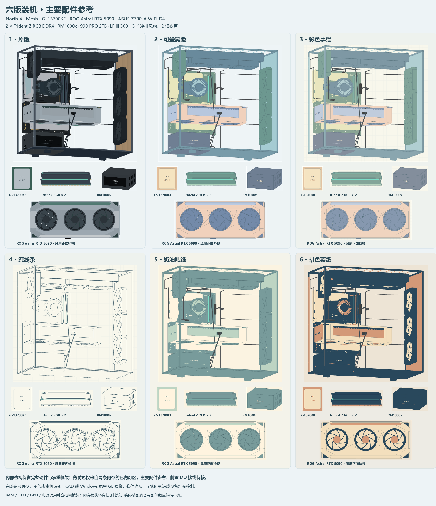

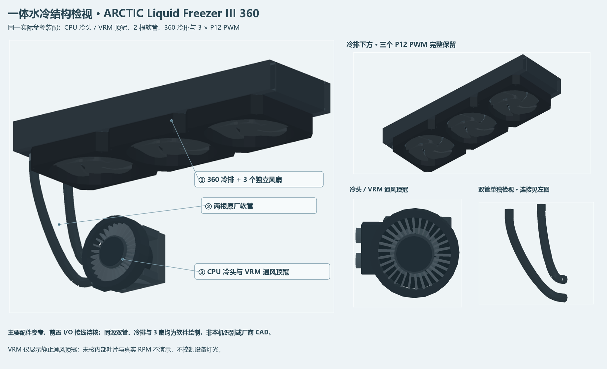

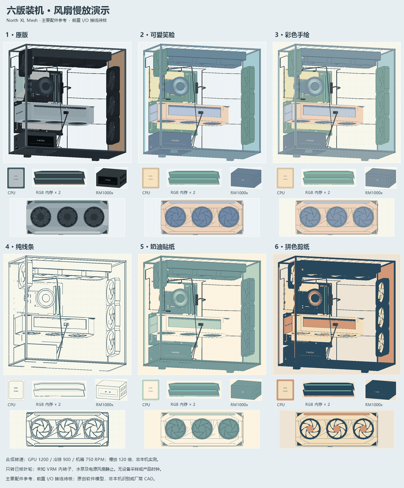

<!-- ASSEMBLY048:END -->

<details><summary>0.47历史修复范围与预览（并非完整装机）</summary>

**0.47.0-preview.1 · 开发候选 · Windows x64 · 仅限许可规定的非商业用途**

修正后排机箱风扇穿入显卡的问题。没有专属安装面的后扇使用上方参考姿态，
创建前同时检查显卡、冷却器、主板及已选电源／存储／扩展卡的保守包络。
整组遇阻时保留冲突原因，不缩显卡、不截风扇、不悄悄改变数量；已编写的安装面不移动。
圆框安装耳片、叶轮完整扫掠也参与检查。48 款已核后扇安装面的检查中，42 组保留、6 组明确拒绝；
保留组对所检查的四类辅助刚性实体无包络重叠。此项不是全部机箱、孔位或实物兼容认证。

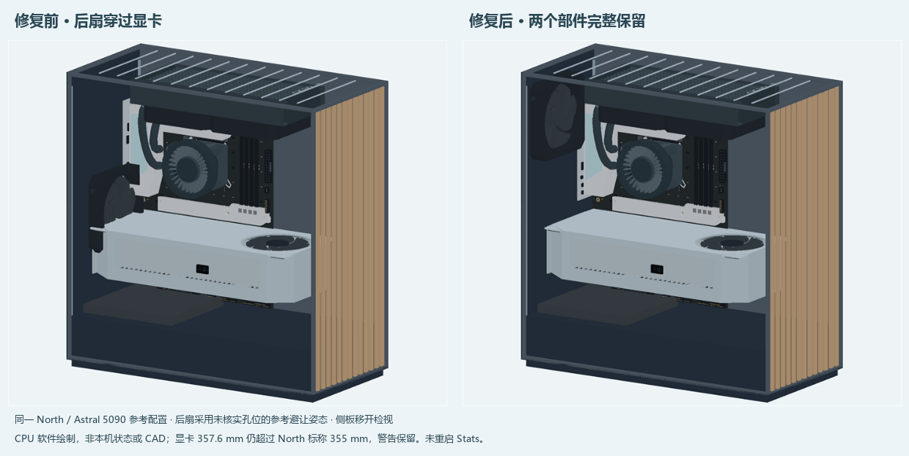

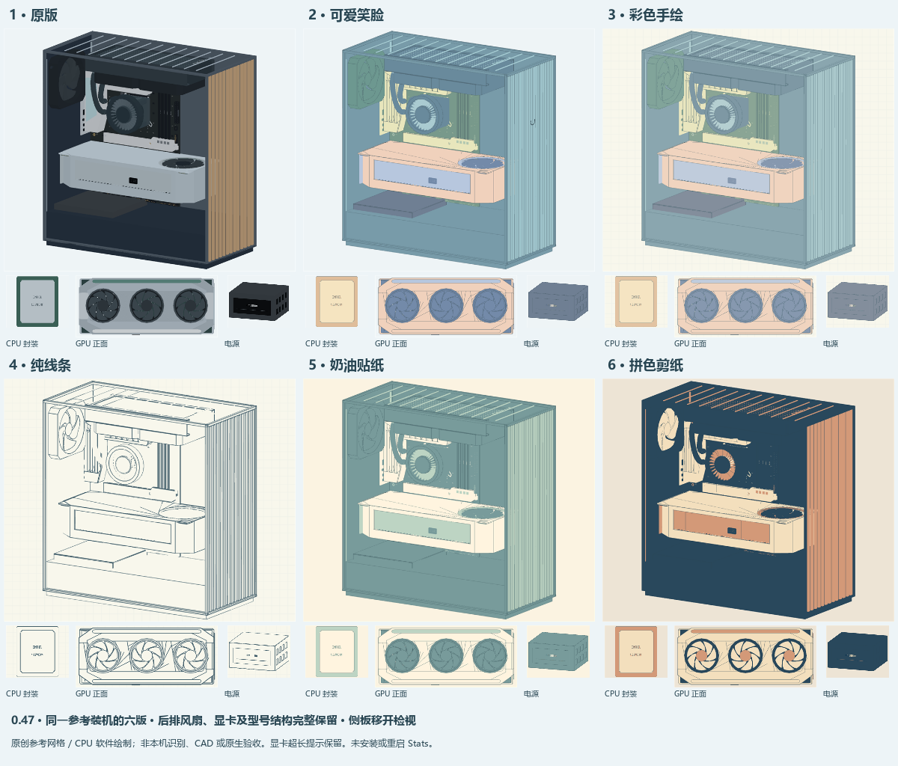

图来自真实生产网格的软件离屏检视，侧板仅在检视绘制中移开。North 参考配置的 Astral 5090
仍超过该机箱标称显卡限长，原提示保留，不能凭图判整机兼容。方法与边界见
[风扇空间检查](docs/CASE_FAN_CLEARANCE047.md)。

外观固定为 **1 原版（`miniature`）、2 可爱笑脸（`cartoon`）、3 彩色手绘（`notebook_color`）、
4 纯线条（`notebook_line`）、5 奶油贴纸（`sticker`）、6 拼色剪纸（`papercut`）**。
原版无笑脸，13 个旧保存选项保留；蓝墨手账不另编号为第七版。
**现有类别、型号和六版细节缺口完成前，不增加新外观。**

本轮补核六款既有主板的装甲、盖板、PCB 与静态材质，保留各型号的轮廓；
原版及纯线条的物理结构不变，四套彩色风格保留这些主板的材质层次。
[六款逐型号六版图鉴](docs/MOTHERBOARD_FINISH047.md)保留来源和未知项；
28 款已有正面照片核看，不等于完整 CAD、隐藏风扇或全部细节完成。

新增 **12 款独立 GPU 冷头参考：8 Alphacool／2 Watercool／2 Corsair**，
保留具体板卡、必要 PCB 修订、端子及背板的来源事实。
这批只供独立外观检视，尚不替换整卡、不自动连管；未知安装孔位和内部水路不补造。
[十二款六版图鉴与限制](docs/GPU_BLOCKS047.md) · [四个数据包及校验值](docs/GPU_BLOCK_PACKS047_INDEX.json)。

本体 **514 个具名产品＋1 套参考组合**，可选 **314 个产品＝72 CPU＋167 冷却＋75 水路部件**，
合计 **828 个具名产品**。75 条含原 63 款水路及本轮 12 款独立 GPU 冷头。
原 15 个水路数据包与新增 4 个 GPU 冷头包均保留；集合／类别／品牌文件是重叠的替代下载，
不重复计产品。原 32 个冷却包和两 CPU 包也保留。目录数量不表示精确 CAD 或全市场完成。
冷排已有 **120／140／240／280／360／420／480／560** 类别，28 款主板含 **ITX／mATX／ATX／E-ATX**；
各品牌缺项与实际规格见[尺寸覆盖](docs/SIZE_COVERAGE.json)、[覆盖说明](docs/HARDWARE_COVERAGE.md)。

图库只为可见复杂卡片串行准备图形，关闭或切换会取消、丢弃过时结果；缓存有界。
隔离测量中，一张复杂泵箱卡的主线程提交约 **1.70–1.75 ms**，原同步准备约 **555–567 ms**；
总计算仍约 **572–582 ms**，改进是界面响应，**不宣称 CPU 用时或整款内存下降**。
CPU／GPU 小组件最小化时暂停快照，恢复读取最新状态；不增加采集器、硬件查询或动画时钟。
范围和方法见[本轮局部测量](docs/SCOPED_PERFORMANCE047.json)。

**0.47 尚未安装；游戏期间不重启当前 Stats、不提权、不显示测试窗。**
CPU 温度重启恢复、顶部栏／设置／详情真实磨砂、屏幕二、游戏隐藏和整款程序占用仍待原生验收。
全品牌全系列、20 款显卡叶型、11 款新增风扇的完整叶片证据、任意水路、线材与外围类别仍有缺口。
完整需求、问题及核对状态写入下方同一份 29 组账本；不把“已加目录”当成“全部完成”。

本轮验证记录见 [QUALITY047](docs/QUALITY047.md)。下方 0.46／0.45 图片为明确保留的历史预览，
不能替代 0.47 改动后的测试或本机原生验收。


</details>

以下 0.46 预览分别使用当前真实 QML 组件或生产三维网格的软件离屏绘制，保留六版中的型号结构；不是本机识别、厂商 CAD 或原生安装验收。

CPU／显卡小组件使用当前真实 QML 组件的软件离屏绘制。读数为合成示例，
不代表本机温度、占用或 Windows 桌面验收；147 款显卡的彩色手绘补回色洗，保留原有型号、盖板开口与叶型。

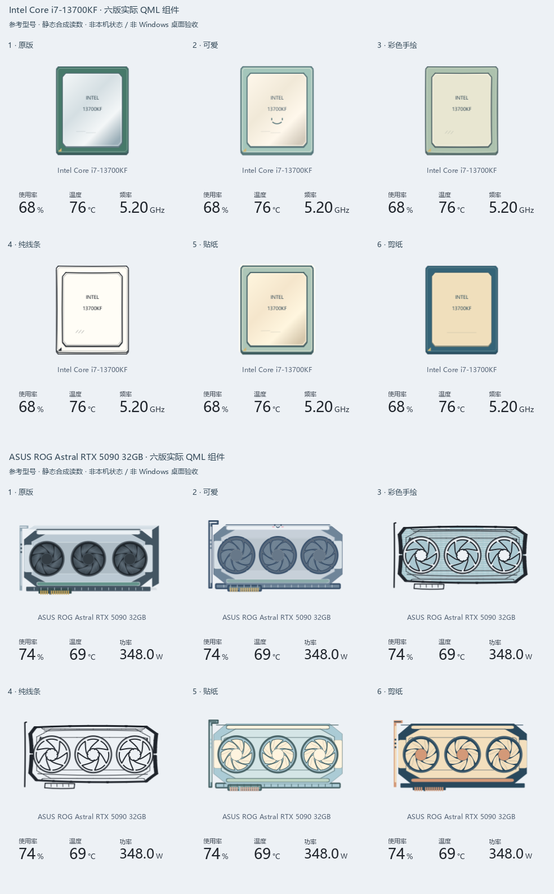

[NVIDIA／AMD／Intel 三款的彩色手绘与纯线条对照](assets/showcase/three-gpus-notebook-color046.png)。
六版叶片的 0→37→0 度软件检视中，固定外框／PCB 区域保持不动；这不是实时 RPM 的原生验收。

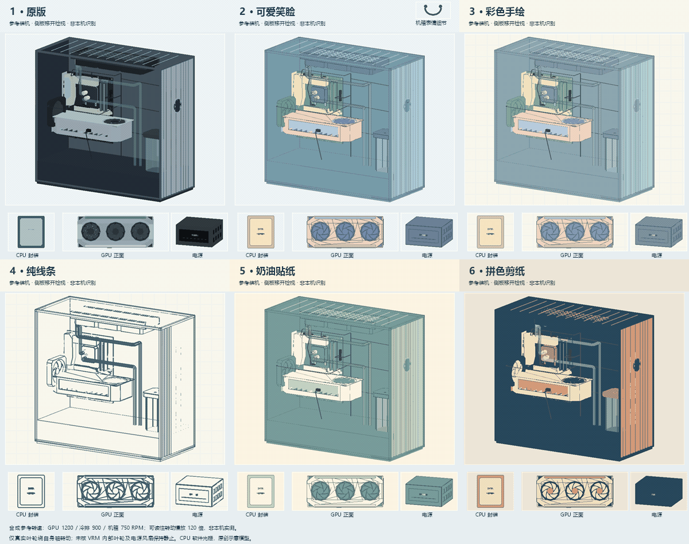

[完整装机六版静态图](assets/showcase/assembly-loop-six046.png) · [四秒动效视频](assets/showcase/assembly-loop-six046.mp4)。
使用与程序相同的型号轮廓转换及网格；GPU 正面小窗只改变相机，整机安装姿态保持原样。
GPU／冷排／机箱风扇使用合成参考转速并慢放 120 倍以便检视，未绑定的电源风扇与泵保持静止。
短时选中反馈为现有策略的软件采样；没有新增运行时动画时钟，不作为原生 GL 或真实测速证明。

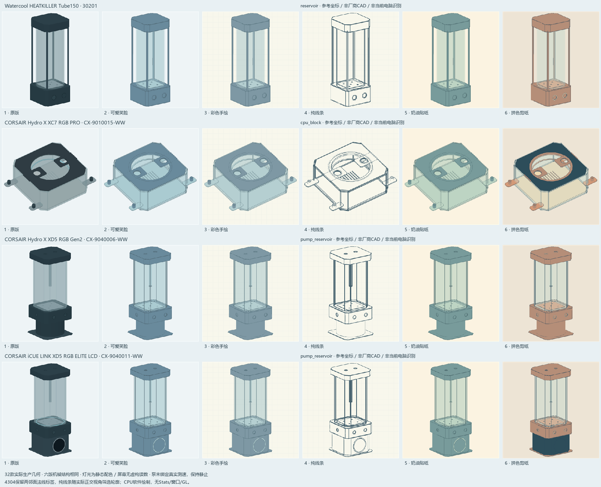

32 款冷头／泵／水箱的六版逐款图：[1](assets/showcase/loop-block-six046-1.png) ·
[2](assets/showcase/loop-block-six046-2.png) · [3](assets/showcase/loop-block-six046-3.png) ·
[4](assets/showcase/loop-block-six046-4.png) · [5](assets/showcase/loop-block-six046-5.png) ·
[6](assets/showcase/loop-block-six046-6.png) · [7](assets/showcase/loop-block-six046-7.png) ·
[8](assets/showcase/loop-block-six046-8.png)。
原版三视图：[1](assets/showcase/loop-blocks-atlas046-1.png) · [2](assets/showcase/loop-blocks-atlas046-2.png) ·
[3](assets/showcase/loop-blocks-atlas046-3.png) · [4](assets/showcase/loop-blocks-atlas046-4.png)。
完整重画包含 32 型号 × 6 风格 × 3 角度，裸电机、泵盖、无泵水箱和含泵组合分别保留；
未绑定真实测速的泵保持静止，灯光是静态配色，LCD 保持空白。

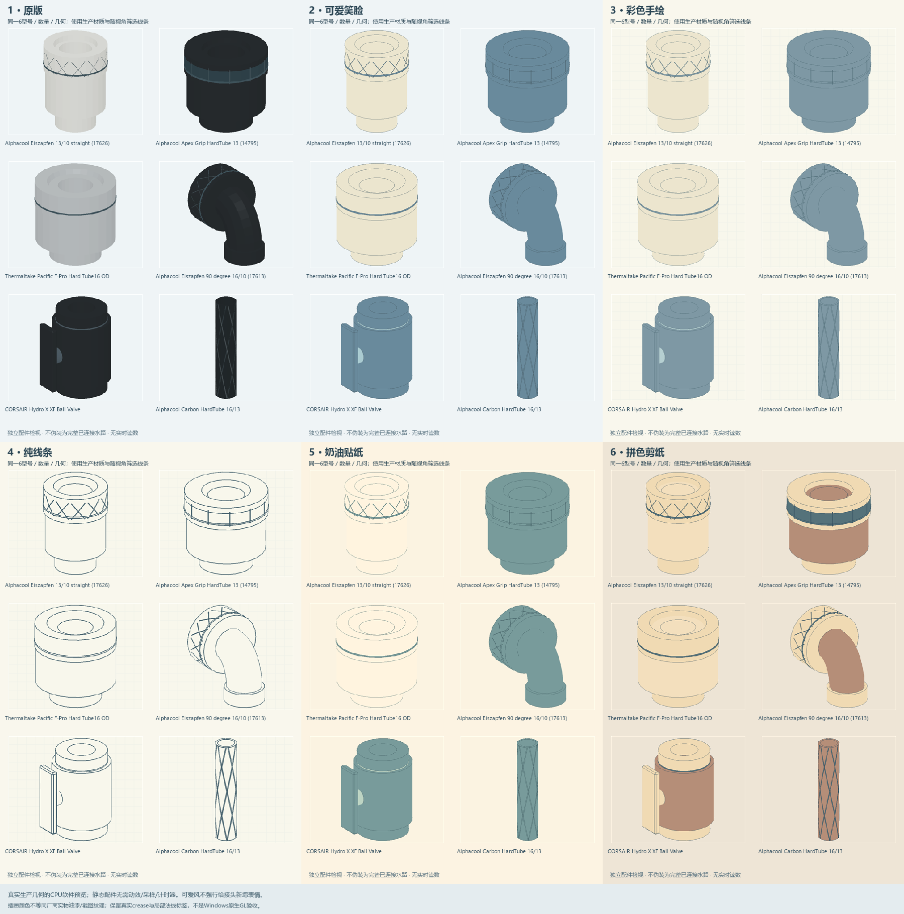

原版完整图鉴：[接头／管材 1](assets/showcase/loop-fittings-atlas046-1.png) ·
[接头／管材 2](assets/showcase/loop-fittings-atlas046-2.png) · [12 款主板本轮细节](assets/showcase/motherboard-details046.png)。

以下保留 0.45 生产模型的 CPU 离屏历史预览，展示同型号在六版中的结构一致性；
不是本机硬件识别、厂商 CAD、Windows 原生 GL 或安装验收。

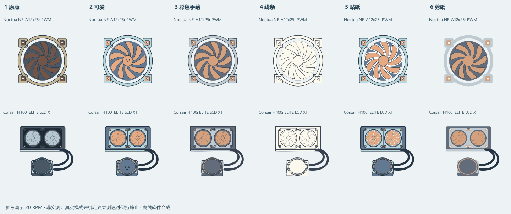

动图使用实际模型的分层叶轮与固定前景，20 RPM 是便于检查叶型的参考演示；未绑定真实测速的部件在实测模式保持静止。没有新增运行时动画时钟。

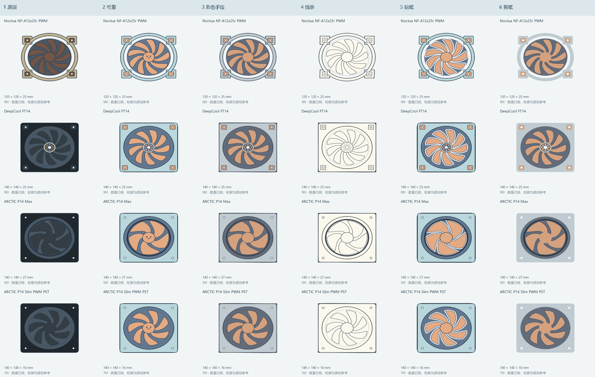

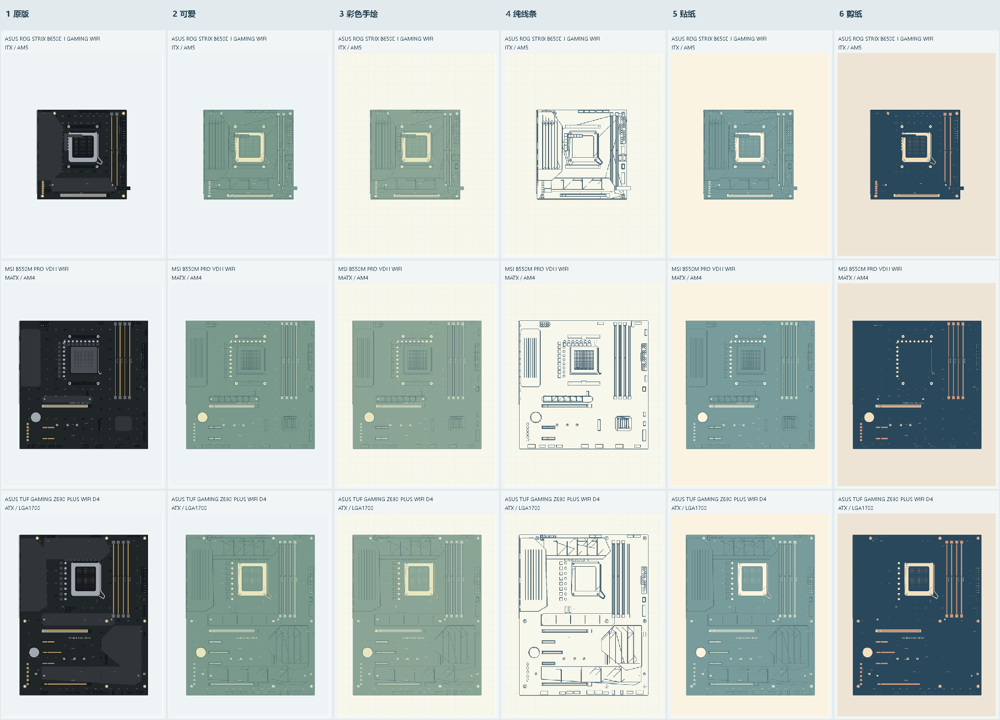

<details><summary>查看本轮原版图鉴、接口细节与其余六版预览</summary>

- 主板：[12款原版](assets/showcase/motherboards-original045.png) · [PGA/LGA、DVI和SATA细节](assets/showcase/board-socket-io045.png)
- 风扇图鉴：[1](assets/showcase/fan-atlas045-01.png) · [2](assets/showcase/fan-atlas045-02.png) · [3](assets/showcase/fan-atlas045-03.png)
- 散热器图鉴：[1](assets/showcase/cooler-atlas045-01.png) · [2](assets/showcase/cooler-atlas045-02.png)
- 冷排图鉴：[1](assets/showcase/radiators-atlas045-01.png) · [2](assets/showcase/radiators-atlas045-02.png) · [3](assets/showcase/radiators-atlas045-03.png) · [4](assets/showcase/radiators-atlas045-04.png) · [5](assets/showcase/radiators-atlas045-05.png) · [6](assets/showcase/radiators-atlas045-06.png) · [7](assets/showcase/radiators-atlas045-07.png)
- 六版结构：[1](assets/showcase/cooling-six045-01.png) · [2](assets/showcase/cooling-six045-02.png) · [3](assets/showcase/cooling-six045-03.png)
- 六版几何近看：[1](assets/showcase/cooling-geometry-six045-01.png) · [2](assets/showcase/cooling-geometry-six045-02.png) · [3](assets/showcase/cooling-geometry-six045-03.png) · [4](assets/showcase/cooling-geometry-six045-04.png) · [5](assets/showcase/cooling-geometry-six045-05.png)

图中的已核／参考／待核状态按产品分别保留；静态图不能证明全部安装间隙或实时测速。
独立零售冷头、泵、水箱、接头与管材的实际缺口和下一批字段见 [水冷部件审计](docs/LIQUID_COMPONENT_GAPS.md)。

</details>

<details><summary>保留的 0.44 独立冷排历史预览（不是 0.45 原生验收）</summary>

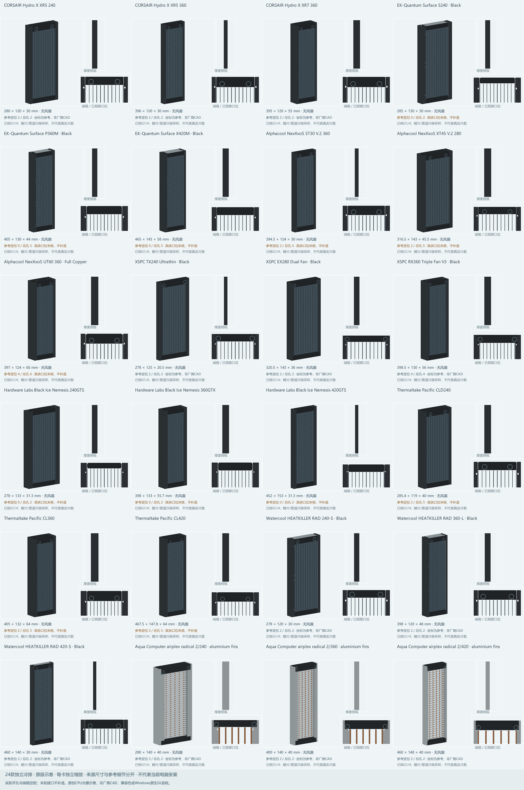

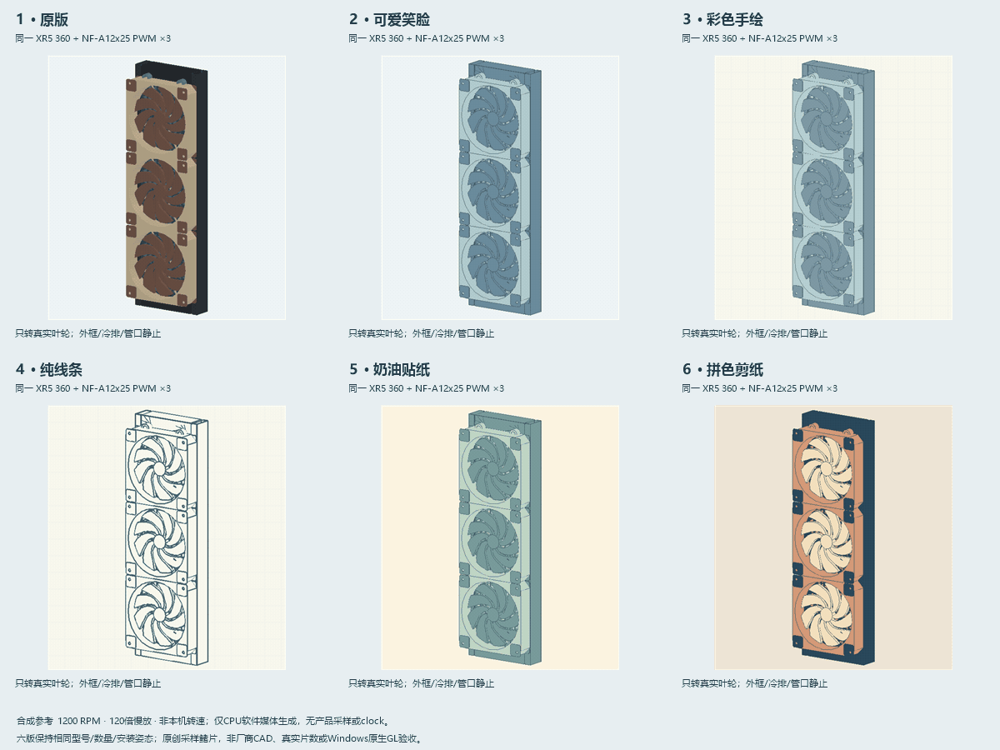

</details>

**全文要求保留为下列 29 组。核对完成不等于产品全部完成；每一项缺口都继续跟踪。**

<!-- REQUIREMENTS:BEGIN -->
## 全文需求逐项核对与未完成清单

核对日期：2026-11-08；当前 0.48.0-preview.1 源码候选。重复要求合并为 29 项，原有组 ID、核心约束和后续补充全部保留。
**当前没有达到“全部做完”的交付条件。** 源码存在、离屏测试通过、旧版实测与当前新版原生验收分别记录；不能用候选包生成或旧版温度读数给新版打勾。
用户要求逐项核对、报告问题与缺项；未完成项继续保留，不因本轮上传或文档更新而关闭。
0.48 尚未安装。游戏期间只做代码、后台和离屏检查，不重启 Stats，不弹出系统授权或可见测试窗；原生验收等待后续允许的桌面时段。

**外观顺序约束：** 1 原版（`miniature`）、2 可爱笑脸（`cartoon`）、3 彩色手绘（`notebook_color`）、4 纯线条（`notebook_line`）、5 奶油贴纸（`sticker`）、6 拼色剪纸（`papercut`）。原版无笑脸；13 个旧保存选项继续保留。**先完成现有类别、型号与六版一致性缺口，不新增外观。**

**0.48 统计口径：** 本体 514 个具名产品＋1 套参考组合；可选 314 个产品＝72 CPU＋167 冷却（104 冷排／40 风扇／23 散热器）＋75 独立水路，合计 **828 个具名产品**。不按风格或下载分组重复计数；共壳 SKU 不等于独立高精度外壳，参考组合不计为产品。
冷却包共 32 个候选数据文件：3 类集合包或 29 个按品牌、类别划分的小包，分组可能重叠，**同一型号不可重复安装**。未装目录默认不加载，不预载全库网格，不新增后台查询；其它品类尚不能全部按包选装。

独立水路可选包收录 10 CPU 冷头／8 泵／4 纯水箱／10 泵箱组合／20 接头／11 管材／12 GPU 冷头（仅独立外观检视）。15 个原水路文件保留，新 GPU 冷头包另见 [047 索引](docs/GPU_BLOCK_PACKS047_INDEX.json)。以各自索引的字节数与 SHA256 为准，不重复计产品。端口姿态、网格与连接路线是原创参考；未知螺纹、插槽或接合保留待核，未通过原生或实物装配验收。

| 编号 | 原始重点／验收要求 | 当前状态 | 实现与证据 | 问题、缺项或下一步 |
| --- | --- | --- | --- | --- |
| 1 | 保留原顶部栏；悬停/点击看历史趋势；可只留顶部栏。 | 已实现；新版原生待验 | 顶部栏、悬停详情、点击固定与历史存储路径均保留，并有专门测试。<br>[top_bar_runtime.py](top_bar_runtime.py) / [history_store.py](history_store.py) | 尚未在本机安装0.48验证真实交互；现有测试文件不等于本轮全部通过。 |
| 2 | Stats优先屏幕2，持久化所选显示器且适配显示器变化。 | 已实现；新版原生待验 | 存在按稳定显示器身份选择、保存和路由窗口的实现，本次不读取实际显示器或用户配置。<br>[top_bar_config.py](top_bar_config.py) / [top_bar_runtime.py](top_bar_runtime.py) | 0.48尚未在实际屏幕2验收；系统UAC提示不能限定到屏幕2。 |
| 3 | 游戏不能覆盖；同屏前台全屏、锁屏和未知桌面状态须隐藏并停动效，安全后恢复。 | 已实现；新版原生待验 | 顶部栏、详情、模型小组件和整机窗口已有按屏幕全屏与安全桌面状态的关闭式门禁。<br>[fullscreen_guard.py](fullscreen_guard.py) / [top_bar_runtime.py](top_bar_runtime.py) | 0.48真实游戏前台、跨屏、锁屏及桌面恢复尚未验收；继续遵守当前不重启要求。 |
| 4 | 排查自行退出、空白栏，恢复并防止再次意外退出。 | 部分完成 | 已实现Explorer替换恢复、初始化/关闭防护和安装包自检。<br>[top_bar_runtime.py](top_bar_runtime.py) / [native_runtime.py](native_runtime.py) | Explorer恢复不等于整个应用进程崩溃后自动恢复；新版长时间无崩溃仍待实际运行。 |
| 5 | CPU温度在每次启动Stats时通过一次授权恢复；只读会话桥接随Stats退出，不开机启动。 | 已实现；新版原生待验 | 有启动恢复开关、一次会话只授权一次、游戏延后、桥接文件校验与跟随父进程退出。<br>[cpu_temperature.py](cpu_temperature.py) / [cpu_temperature_launcher.py](cpu_temperature_launcher.py) | 未对0.48重启或提权，未取得新版真实温度；0.36温度不作为0.48验收。<br>自动恢复默认需用户开启且依赖支持来源；无法保证所有电脑都有CPU温度。 |
| 6 | 顶部栏、设置、详情都应恢复真实磨砂，并保留颜色底色与连续透明度。 | 已实现；新版原生待验 | 三类窗口有原生材质、宿主桥接和生命周期实现，离屏测试只能验证契约。<br>[native_glass.py](native_glass.py) / [material_policy.py](material_policy.py) | 顶部栏、设置、详情三个真实Windows窗口仍待0.48桌面验收；不能以离屏底色冒充真实磨砂。 |
| 7 | 持续优化CPU/内存/GPU负担，并最终报告实际控制到多少。 | 部分完成 | 保留共享时钟、按需采集与模型缓存；独立水路6次索引扫描合为1次。隔离热选择器微基准CPU中位约减少81%；63产品索引对象63170B、至多8记录79963B只属递归Python对象图，不含模块／Qt／mesh／GL或进程RAM。 图库只为可见项串行准备复杂图形，关闭取消旧结果；小组件最小化暂停快照，恢复读取最新状态。局部响应测量不当作CPU用时下降或整款内存。 内置离线图集只读内置目录，不导入用户扩展包或配置目录；程序内图库照常保留可选配件。<br>[native_runtime.py](native_runtime.py) / [HardwareGlyph.qml](native/HardwareGlyph.qml) | 没有0.48安装版静置或游戏状态的整款程序CPU／RAM／GPU实测，也未完成关闭后资源回收验收。<br>历史隔离设置首用约65MiB差值、0.43典型GPU基础图层39.85%像素预算减少均有限定范围；不是0.48常驻内存或显存降幅。<br>打开3D、浏览图鉴与仅顶部栏的负担不同；离屏生成耗时、单模块内存和包体积不能作为通用占用上限。<br>新SVG最坏构建时延仍在优化，未标记性能全部完成；本机游戏状态与静置的整款程序CPU／RAM／GPU占用仍待安装后原生验收。 |
| 8 | 每类硬件显示消耗最多的前5个软件，按需采集以降低占用。 | 部分完成 | 已有CPU、内存、GPU、专用显存与进程总读写I/O按需Top5；I/O复用同一份Windows进程快照，显示读/写/合计bytes/s，按软件聚合，隐藏后停止租约采集。<br>[process_usage.py](process_usage.py) / [process_snapshot.py](process_snapshot.py) | I/O范围为所有进程读写，含缓存与设备；Windows计数还可能包含文件、网络等I/O，不能与当前选中物理磁盘绑定，不能叫单盘Top5。<br>网络逐进程Top5仍未实现；温度／转速等物理读数不能直接按进程归因。<br>预热、权限缺失、PID复用和计数倒退必须保留未知／重建基线；当前没有本机0.48原生交互验收。 |
| 9 | 原版不得加笑脸；保留可爱/手绘/线条等六版编号及所有13保存选项。 保留上传版12的布局／动效与原图标，新方案不能替换掉旧方案。 | 已实现；保留离屏证据 | 六套固定编号miniature/cartoon/notebook_color/notebook_line/sticker/papercut与13个保存值共存；原版无笑脸，只有明确的可爱／笑脸手绘方案可表情。<br>[top_bar_config.py](top_bar_config.py) / [HardwareShapes.js](native/HardwareShapes.js) | 固定展示编号仅1—6，其余七个保存选项继续保留；不以历史额外编号扩充新方案。<br>在现有类别、型号、真实细节与六版一致性缺口闭环之前，不新增外观。 |
| 10 | 每套硬件数量、型号与结构跟原版一致，不能不同风格换壳/减配。 | 已实现；未核结构仍是参考 | 支持的型号在六套展示方案及13个保存值中共用尺寸、型号、叶轮数量、转轴与结构目录；逐件混搭只调画法，不减配或套另一型号的壳。 0.48修正拥挤线稿里RAM、电源、冷头／软管与供电线主要轮廓的分配顺序，保留既有边线预算；同数量仍需实际逐图核对。<br>[HardwareModelDetails.js](native/HardwareModelDetails.js) / [HardwareShapes.js](native/HardwareShapes.js) | 相同数量和可生成13种画法不代表每个型号六版都已逐张视觉验收；未知叶型、隐藏PCB、小IC和安装细节仍是参考。<br>更多未收录水路产品、GPU冷头、线材与外围设备在六版中同样仍缺；本轮12个GPU冷头仅独立外观检视，不代表整卡安装或全部型号完成。 |
| 11 | 风扇每版能转；必须按真实对应RPM调整，过期/未知/零速停止；风扇设计须符合型号。 | 部分完成；未知测速保持静止 | 已有GPU叶型／RPM型号和时效门禁；机箱／冷排选扇身份独立，演示转动与真实测速分开，沿用既有共享时钟，未知／零速／过期保持静止。<br>[hardware_fan_profiles.py](hardware_fan_profiles.py) / [top_bar_feedback.py](top_bar_feedback.py) | 核对原账：26个GPU待核条目中6个已补核，仍有20个叶型资料不完整；新增40款风扇中11款叶片证据仍未完整。<br>机箱、冷排、电源及板载小风扇并非普遍有可绑定的独立测速；CPU_FAN可能是泵，不能拿来驱动全部风扇。<br>两款主板仅绘制MSI无叶片风扇槽与ASUS网罩参考；其中ASUS内部风扇位置未核，两款叶片、旋向和RPM都未知。 |
| 12 | 全部显卡品牌/系列/年代、丐版及旗舰非公、10系列及更早、AMD和Intel都要覆盖并保真。 | 部分完成 | 当前147款显卡含92款NVIDIA、46款AMD、9款Intel，涵盖一部分旧卡、公版和非公型号。<br>[hardware_variants.py](hardware_variants.py) / [hardware_variant_art.py](hardware_variant_art.py) | 147个独立GPU（NVIDIA92／AMD46／Intel9）仍非全市场；原账20个叶型待核，本轮0个新增完整叶型核实。<br>旧代／入门／旗舰非公、工作站与新代际仍缺，内部PCB、电路与部分精确接口位置不是制造CAD。 |
| 13 | 不同CPU/内存品牌与型号结构也要分开，所有风格均覆盖。 | 部分完成 | 基础3款CPU、可选72款CPU与28个内存型号有共享目录；同封装CPU诚实共用结构。<br>[cpu_catalog.py](cpu_catalog.py) / [cpu_package_runtime.py](cpu_package_runtime.py) | 尚未覆盖全部CPU/内存品牌型号；75个CPU产品共享7类封装，未核封装尺寸、触点位置保留参考。 |
| 14 | 自动识别具体品牌/系列与实物外观，不能仅靠通用GPU名称误选非公版本。 | 部分完成 | 有型号置信度、精确匹配与手动覆盖，不确定时明确回退。<br>[hardware_appearance.py](hardware_appearance.py) / [hardware_variants.py](hardware_variants.py) | 通用RTX5090名称不能区分品牌非公；DIY机箱、散热器、电源通常无可靠固件型号，只能手选参考。<br>主板严格完整型号与品牌匹配；B550M DS3H无PCB revision时不能自动猜成rev.1.5；参考替换不能借用另一件硬件的实时温度或RPM。 |
| 15 | CPU/GPU图标要够大，布局清晰可爱，去掉角落可见缩放边角，支持有框/无框。 | 已实现；新版原生待验 | 已有大图CPU/GPU模板、共享响应式布局、真正QML动态图层、读数和每组件框架开关。<br>[widget_catalog.py](widget_catalog.py) / [responsive_layout.py](responsive_layout.py) | 原生透明命中、屏2缩放和实际尺寸仍待0.48验收；布局测试不能单独证明美术细节达到用户审美要求。 |
| 16 | CPU效果/GPU叶轮是动态图标；只改变换，不添加轮询，隐藏/锁屏/游戏时停止。 | 已实现；新版原生待验 | MetricIcon/HardwareGlyph沿用已有时钟与数据时效，Runtime控制modelMotionAllowed。<br>[MetricIcon.qml](native/MetricIcon.qml) / [HardwareGlyph.qml](native/HardwareGlyph.qml) | 0.48真实游戏时帧活动与合成器负担未实测；未知传感器的静止表现是刻意安全行为。 |
| 17 | 桌面可旋转缩放3D机箱加硬件；点选配件查看状态，有框或无框。 | 已实现；新版原生待验 | 已有桌面整机窗口、旋转缩放、拾取、部件状态快照和可选边框。 0.48增加内部检视：只调整外盖与电源罩的绘制及拾取可见性，保留原始物理场景和正常完整外壳。<br>[assembly_desktop_widget.py](assembly_desktop_widget.py) / [assembly_window.py](assembly_window.py) | 参考配件不能借其他硬件的实时读数；机箱/电源/存储等不都有独立实时状态。<br>关闭事件返回时viewport._scene等引用可能保留至QObject实际销毁；不能声称瞬间全部释放。 |
| 18 | 机箱要多、各品牌系列结构像实物，支持风格切换并自动匹配。 | 部分完成 | 已有96款机箱、26品牌和多种布局，共享全部风格；自动识别只允许已核固件匹配。<br>[chassis_catalog.py](chassis_catalog.py) / [assembly_case_exteriors.py](assembly_case_exteriors.py) | 96款／26品牌仍远非市场所有机箱；尚无已核零售机箱固件映射，未知须手选参考。<br>门铰、支架、托架、背线空间、同壳变体与大量内部安装间隙仍需逐款核实；机箱尚未迁移为运行时可选数据包。 |
| 19 | 主板应像真实型号；ITX/mATX/ATX/E-ATX、插槽、PCB、接口、CPU位置与安装孔分别核对。 | 部分完成 | 28个主板保留原手册布局；0.47对6款旧记录补官方照片装甲/PCB/静态材质，两ITX和ATX/mATX/E-ATX各自轮廓保留。仅上述6板在四个彩色风格保PCB/金属层次，其余22数据、物理网格及六版颜色不变。<br>[assembly_motherboard.py](assembly_motherboard.py) / [motherboard_catalog.py](motherboard_catalog.py) | 小IC、电容、走线、焊点、背面与部分安装孔／盖板仍为参考，不是厂商PCB CAD或全装配保证。<br>品牌、旧LGA／Intel／工作站及Threadripper等平台仍有空档。<br>28款已有正面照片核看不等于精确CAD、全部电路、暗藏风扇或实物安装验收。Taichi内部风扇位置、两款叶片/方向/RPM等未知项保留。 |
| 20 | 散热器/风扇按品牌系列真实细化，风冷、水冷、机箱风扇全部风格都有。 | 部分完成 | 本体66套散热方案（含1套非零售参考）／70个风扇条目；可选包保留23款散热器、40款风扇，区分下压／单塔／双塔／被动／AIO、异厚扇、LCD与特殊双轴孔距。<br>[cooling_catalog.py](cooling_catalog.py) / [assembly_cooling.py](assembly_cooling.py) | 新增40款风扇中11款叶片证据尚未完整；全目录仍有绝对方向、孔径、公差、鳍片、热管与装配间隙待核，不能把定性叶型当CAD。<br>尚未覆盖所有品牌系列；不同冷排尺寸不自动证明共用同一泵头、风扇、软管或安装位置，LCD保持参考画面。 |
| 21 | 电源、存储、扩展卡等装机模拟器有的品类都要有，型号/外形也需逐类完善。 | 部分完成 | 本体21电源、29存储、3扩展；原63可选水路继续保留，0.47增加的12个严格来源GPU冷头独立模型（8 Alphacool/2 Watercool/2 Corsair）。具体显卡/修订与端子变体分开；缺安装pose不接整卡替换或连管。<br>[component_catalog.py](component_catalog.py) / [component_storage043.py](component_storage043.py) | 电源／存储／扩展与75条独立水路记录仍非全品牌全系列；内部电路、细部与净空未核就保留参考。<br>12个GPU冷头已有具体兼容来源，但完整市场覆盖、实际安装姿态／整卡替换和连管仍缺；更多接头／管材、线材、外设与输入输出设备继续待补。 |
| 22 | 全部配件可自由换型号并混搭所有风格装入同机箱。 | 已实现；兼容检查不完整 | 保留型号选择与逐件风格；新独立水路区分冷头／泵／泵盖／水箱／泵箱、逐口接头与管材。当前固定3／4节点循环，有限静态避障与未知／不支持提示，不强缩硬件。 后排参考姿态和已选实体空间检查补强；空气/一体水冷也先生成一次电源/存储/扩展实体供风扇避让，冲突整组提示，不裁部件或静默少装。 0.48显式参考按钮补齐CPU、GPU、主板、两条匹配RAM、电源、SSD、线缆与冷却；未知本机内存仍不自动伪装有条。水冷软管端部连接按实际生成网格修正。<br>[assembly_config.py](assembly_config.py) / [assembly_parts.py](assembly_parts.py) | 只允许已支持型号／结构；端口位置仍参考，未实现任意连接图、inline硬管转角或全实物干涉／公差求解。<br>HAF700EVO与5000D的指定参考配置可生成3条路线；O11／Y70空间不足仍review，不代表各机箱／全硬件组合都通过。<br>风扇采用保守参考包络；没有完整制造孔位、公差或任意管线净空保证。GPU冷头仅独立检视，不能当成完整装机水路。<br>明确参考装机与全部现实组合不同；当前预设、安装孔位、遮挡和逐条线缆仍按各自证据核对，不能只看一张整机图就判全完成。 |
| 23 | 每品牌水冷；冷排与风扇可独立选择，支持无扇/单面/夹心并保持AIO原厂边界。 | 已集成；验收范围见报告 | 本体24＋可选104独立冷排保留120至560尺寸等级；主／第二排、独立前后扇、无扇／单面／夹心与AIO原厂封闭保护保留。保留既有63条手选水路部件和静态参考连接。 LFIII的VRM风扇、泵和冷排风扇按真实角色分开，AIO软管修正泵端缺段与冷排端切向；未核RPM不借用CPU_FAN。<br>[liquid_cooling_catalog044.py](liquid_cooling_catalog044.py) / [assembly_radiator044.py](assembly_radiator044.py) | 名义120／140／240／280／360／420／480／560不等于每品牌全尺寸或实际长度、孔距、间隙均核。<br>孔径／螺钉／公差、内部鳍片／水道、精确口位和机械安装仍未齐；未知口不造接头或假管。<br>固定3／4节点不是任意连接图，inline硬管弯头未接；0.48尚未安装，不关闭原生装配交互验收。<br>LFIII参考的8条已知线路仅含4条主要供电和4条机箱扇线，未包含冷头一体PWM控制线；品牌专用灯控／集线器线路也未逐型号齐备。不能把水管连续当成电气接线完整。 |
| 24 | 不同风格提供特效/灯区，固定白灯不变彩灯，不新增未知RGB。 | 部分完成；多类灯区仍缺 | 已有灯区静态配色／熄灯与有限时特效；固定白灯与未知灯区分开处理，换色复用物理网格，不新增时钟。 0.48参考装机明确选择已核RGB内存以展示已有灯区；此前North示例灯区为零，不能作为灯光展示。非ARGB的LFIII和P12不补造彩灯。<br>[assembly_lighting.py](assembly_lighting.py) / [assembly_style.py](assembly_style.py) | 不是真实灯控、RGB时间轴或全局泛光；只处理已有模型灯区。沿用插画模式保留原画法，指定配色时固定白灯不变彩灯。<br>目前是已有灯区的静态预览和风格短时效果；尚无逐设备灯控／RGB时序仿真。<br>静态灯区配色不同于实物灯控、全局泛光或连续RGB时间轴；离屏软件图也不代表原生GPU灯效验收。<br>显卡本体、板载装饰灯区与LOKI电源的RGB链未贯通；主板RGB插针不是发光灯。GPU冷头图库已有静态配色也不等于已接入逐型号熄灯或灯控。 |
| 25 | GitHub按类拓展包下载，自选喜欢的模型且轻量，不预载全部网格。 | 部分完成 | 可选规模统一采用上方当前结构化统计；集合、类别、品牌文件是有重叠的替代下载，不重复计产品。原15水路包、32冷却包和2CPU包保留，0.47增加的GPU冷头4包含12个独立参考。未装目录默认不导入，已选记录共享8条LRU，无新增采样；内置离线图集不读用户包。<br>[hardware_packs.py](hardware_packs.py) / [cpu_package_runtime.py](cpu_package_runtime.py) | 集合、类别、品牌文件可能含同型号，不能重复安装或把分组文件数计作产品数。<br>机箱／GPU／内存／主板／电源／存储等运行时可选包仍缺；HTML／SVG图鉴不是可导入数据包。<br>0.48数据路径与离屏检查不代表已安装原生验收，模块／作者脚本内存不等于整款Stats常驻占用。 |
| 26 | 上传GitHub并标版权，原创作品禁止商业使用盈利，保留应有第三方例外。 | 原创非商用；保留既有许可例外 | PolyForm非商用范围、原创插画/3D说明、来源及第三方/既有授权例外均有文档。<br>[LICENSE](LICENSE) / [LICENSING.md](LICENSING.md) | 不能撤销MIT/LGPL等已有许可，不能技术阻止复制；商标权未获授权，本次未做法律审查。 |
| 27 | 合并PR#1到main、上传新版、安装测试通过再发布；当前阶段禁止重启。 | 源码候选；安装／原生待验 | PR#1已合并（历史记录）；0.46源码和15真实水路下载已核。0.47修复候选保留独立源码分支与893文件清单，0.48继续核对整机完整性，安装与原生验收仍未完成；游戏期间不重启、不提权。<br>[product_version.py](product_version.py) / [export_source.py](tools/export_source.py) | 0.48源码／候选包按本轮实际记录校验；未安装，也未做CPU温度、磨砂、游戏隐藏或整款资源的原生验收，不能拿旧结果替代。 |
| 28 | 品类、覆盖与真实细节达到并超过Steam装机模拟器1/2；高标准慢慢打磨全部细节。 | 尚未达到 | 本体、可选产品与参考组合数统一采用上方当前结构化统计，避免叙述重复后漏更。局部官方公告仍为261条（10合并变体）、15严格名称命中／246未匹配待核；不是完整游戏数据库，也未达到或超过PCBS1／2全覆盖。<br>[HARDWARE_COVERAGE.md](docs/HARDWARE_COVERAGE.md) / [ASSEMBLY_QUALITY.md](docs/ASSEMBLY_QUALITY.md) | 局部261条是列表出现次数，不是PCBS全库；246未匹配不等于确认缺246款，名称匹配也不证明精度或兼容。<br>未达到／超过PCBS1／2覆盖与细节；其1200+宣传口径不同，不计算完成百分比或确定SKU差额。<br>更多GPU冷头、实际板上安装、更多水路／线材／外设和真实硬件细节、任意装配与本机原生资源仍有缺口。 |
| 29 | 全文所有重点写入README；全部完成后逐一核对并汇报问题和缺项。 | 已逐项核对；项目仍未全部完成 | README由结构化总账生成并检查一致性；保留29组原ID，逐条分开记录源码、历史测量、离屏证据与0.48尚未完成的原生验收。<br>[README.md](README.md) / [export_requirements.py](tools/export_requirements.py) | 核对完成不代表全部产品功能交付；任何未完成类别、型号、实时来源与实测项继续保留。 |

**尺寸与板型矩阵（已收录记录，不是全市场覆盖或实物兼容保证）：**

| 名义散热等级 | 独立冷排记录（本体＋可选） | AIO 记录（本体＋可选） |
| --- | ---: | ---: |
| 120 | 18 | 2 |
| 140 | 9 | 1 |
| 240 | 25 | 7 |
| 280 | 14 | 4 |
| 360 | 28 | 19 |
| 420 | 13 | 2 |
| 480 | 16 | 未收录 |
| 560 | 5 | 未收录 |

| 主板板型 | 具名记录 |
| --- | ---: |
| ITX | 6 |
| mATX | 9 |
| ATX | 10 |
| E-ATX | 3 |

120／140 等名义等级不等于实际长度、孔距或安装间隙；每个品牌／系列的尺寸空档、原始来源和未核项见 [尺寸覆盖表](docs/SIZE_COVERAGE.json)。
**PCBS 对照范围：** 当前只比较局部官方公告的 261 个列表出现条目（含 10 个合并变体），15 项严格名称匹配、246 项未匹配／待核。不是完整游戏数据库，也不是确认缺少 246 个 SKU；不据此算完成百分比。见 [PCBS 差距与来源](docs/PCBS_GAP_ANALYSIS.md)。

**硬件覆盖与质量未完成项：** 原账仍有 20 个 GPU 叶型待核，本轮没有新增完整叶型核实；新增风扇中 11 款叶片证据未完整；0 款主板 finish 仍待官方来源。两款板载小风扇仅有 MSI 无叶片风扇槽与 ASUS 网罩参考，另 1 款内部位置未知；两款叶片、方向和 RPM 都未知。
全品牌全系列、全部旧代非公显卡、机箱／主板／散热器仍未覆盖。GPU 冷头的安装孔位与整卡替换／连管、更多接头／管材规格、线材与外围设备类别仍缺；单纯芯片名不能确认冷头兼容。
参考组合不等于已有独立零售 SKU；水路部件需要拆开的身份、尺寸、端口与验收字段见 [独立水冷缺口](docs/LIQUID_COMPONENT_GAPS.md)。
机箱／GPU／内存／主板／电源／存储等运行时可选包，以及网络逐进程 Top5、真实单盘进程归因仍未完成；进程总读写 I/O 已实现，不能冒称当前物理盘占用。
现有冷排、机箱与硬件都保留未核孔位、内部 PCB、细小封装或安装间隙标记。不得把“有这个型号”写成“所有细节已核”。
**原生验收未完成项：** 0.48 重启后的 CPU 温度授权恢复、顶部栏／设置／详情真实磨砂、屏幕二定位、游戏隐藏与恢复、关闭资源释放及整款程序 CPU／RAM／GPU 占用。历史图层、模块和离屏测量保留原范围，不能替代本轮实测。
具体源码、测试路径和逐项缺口以 [结构化需求清单](docs/REQUIREMENTS.json) 为准；逐产品进度见 [覆盖清单](docs/ASSEMBLY_CATALOG.json)。
<!-- REQUIREMENTS:END -->

## 0.43 六版演示与已保留功能

以下保留 0.43 历史候选的实际 CPU／GPU 离屏动效与参考整机预览。该节的历史计数、
图层与模块测量保持原有范围；当前 0.45 计数以上方总账为准，不把旧截图或测量当作新版原生 Windows 验收。


该轮展示并保留 **六套编号外观**：**1 原版、2 可爱笑脸、3 彩色手绘、4 纯线条、
5 奶油贴纸、6 拼色剪纸**。原版没有笑脸；其它七套旧选项继续保留。
同一型号在全部十三套外观中共用物理结构、风扇数量与转轴，换画法不换硬件。
下列 CPU／显卡是实际小组件的离屏软件渲染；读数为合成示例。整机是同一份生产模型，
展示参考装机，不是对本机识别结果；风扇演示按 120 倍慢放，各动图只播放一遍。

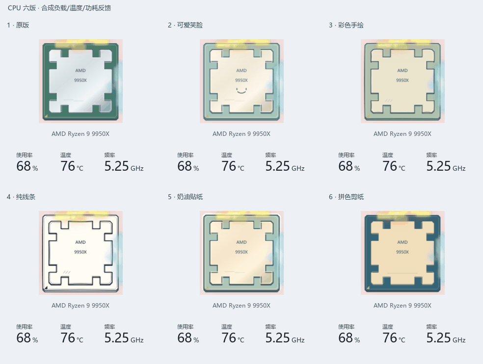

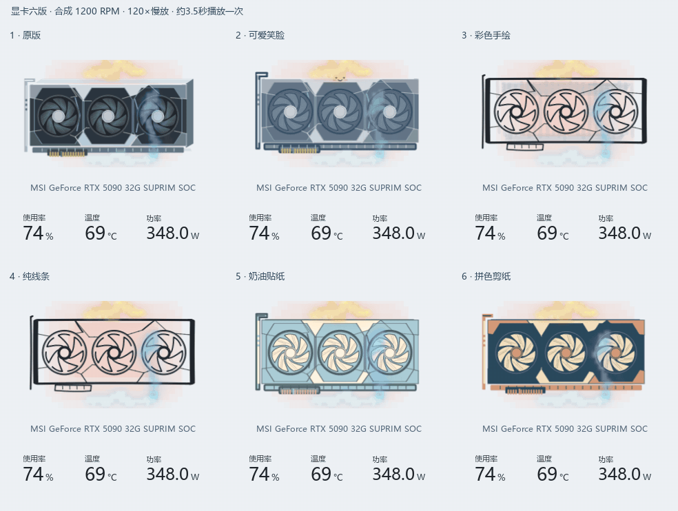

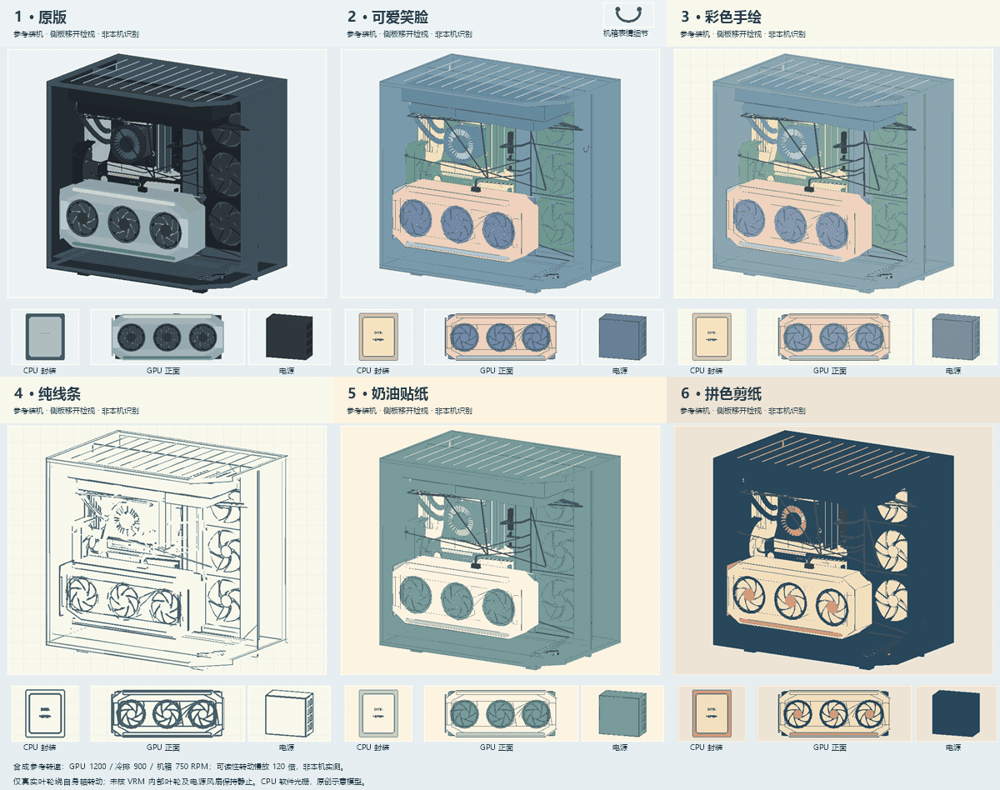

[六版风冷结构](assets/showcase/assembly-air-six043.png) · [六版一体水冷](assets/showcase/assembly-aio-six043.png) · [六版自定义水冷参考](assets/showcase/assembly-loop-six043.png)


CPU 盖板的负载提示收成细条，型号刻字和显卡叶轮不会被中央色块遮盖。
显卡基础纹理按实际可见区域生成，典型 300×300 小组件的该层 RGBA 像素预算从
272,484 降至 163,908 字节，减少 **39.85%**；这是基础图层预算，不是整款软件的内存或显存降幅。
156 组实际 QML 对比的通道差在 8/255 以内，另 8 组小数尺寸对比逐像素一致；
没有增加硬件采样、后台服务或动画时钟。叶轮仍只使用对应设备的新鲜有效 RPM，
未知、过期和零转速保持静止；模型、静止层和转动层按需生成后复用。

逐项核对现有 **147 个显卡型号（NVIDIA 92／AMD 46／Intel 9）**，目前均有具体前壳轮廓。
本轮从原 26 个叶型待核 SKU 中完成 6 项：BIOSTAR RX 7600 基础款 9 叶、OC 款 11 叶、
Intel A770 LE 15 叶、PowerColor Reaper 9070 XT 9 叶、GTX 1080 FE 径流 53 叶、
MSI R9 290X 公版径流 45 叶。每项只绑定该完整型号，不借其它版本的风扇资料。
余下 20 项仍分开记录部分已核、图片不足或官方来源不可用，不画猜测叶片。
见 [逐型号进度](docs/GPU_MODEL_PROGRESS.md) 与 [本轮来源审计](docs/GPU_RESEARCH043.json)。

配件库新增 **24 款存储产品／结构变体**，包含 M.2 2230／2242／2280／22110、
原厂散热片 NVMe、2.5 英寸 SATA SSD 与 3.5 英寸机械硬盘，共 29 项。
原厂散热器与 PCB／参考 IC 分开构建，保留长向鳍片、横向分槽和平整封盖的区别；
未核的具体鳍片数与 IC 排布仍是示意。M.2 根据手册已核长度选择空闲槽位，
没有已核可用位置时不强行放入，电气兼容与散热盖板间隙仍需实物检查。

主板电源口增加独立内缩触点，M.2 插座改成真正开口接收槽；原锚点、线缆端点与插槽数量保留。
参考整机只增加 1 个网格、624 个三角形（0.587%），仍遵守原有细节预算。
风冷、一体水冷、自定义水冷参考装机继续保留完整塔体、泵头、冷排、管路及已选风扇。
新增 **灯区预览**：沿用插画／熄灯／暖白／薄荷／紫色，仅对已有灯区做静态色彩预览；
固定白灯仍保持白色，不控制设备、不推断未核灯区、不增加时钟，切换颜色复用物理网格。

0.43 当时的本体共 478 个具名产品记录，另有 1 套自定义水冷参考组合；
两个可选 CPU 包再补 72 款，合计 **550 个产品记录**。这是产品数，不是独立网格数，也不乘以风格数。
目标按《装机模拟器 1／2》的品类深度逐批补齐；PCBS 2 官方公开基准为 1200+ 配件，
本项目尚未达到该覆盖量或还原度，不把系列、同封装 CPU 或换色视作独立实物外形。
见 [覆盖量与差距](docs/HARDWARE_COVERAGE.md)。

CPU／显卡模型桌面小组件可切换有框与透明无框。整机桌面视图可旋转、缩放、点选部件；
同屏游戏或锁屏时暂停并隐藏，安全恢复后置底。顶部栏模式延后准备设置和桌面组件，
没有打开三维视图时不预载模型。这批候选只完成后台离屏测试和打包，**不重启、不替换当前安装**；
Windows 桌面透明合成、游戏不覆盖和新版整机占用仍需之后单独验收。

独立的 **硬件型号图鉴**：96 款机箱、66 套散热方案、21 款电源、70 个风扇条目，
本体共 253 个条目（含两种散热器附带风扇与 1 套自定义水冷参考组合）；0.45 可选包另加 40 风扇与 23 散热器。均有原版、可爱笑脸、彩色手绘、
纯线条等 13 套外观。保留玻璃转角、木饰板、塔体、泵头、孔栅和叶轮等系列区别；
原版保持无表情，未核实的结构明确标作参考细节，尚未覆盖全部市售产品。

0.43 新增 16 款机箱、12 套散热方案和 16 款风扇。区分圆管开放机架、水平测试台、
倾斜开放机架、NAS 硬盘仓、伸缩 ITX、低矮直立机箱与双列风扇安装轨；机箱目录现覆盖 26 个品牌。
NH-P1 保留 13 片大间距穿孔鳍片与零风扇；Fuma 3 前薄后厚的风扇分别使用 11/9 叶，
LCD 和导流网保持在静止层，反叶型号区分叶型而不捏造旋转方向。泵头分别绘制厚排方盖、
Nucleus 圆盖与 PANORAMA SE 曲面 L 屏；屏幕留空，灯色只是示意。未核实的孔位、
微观叶型、尺寸轴向和装配间隙均保留参考标记，不把支架当成已安装硬件。

NH-L12S、NH-C14S、Dark Rock TF 2 和 CNPS9900 MAX 重新绘制共用透视的扇框、叶轮、
薄鳍片、热管与遮挡；底置风扇采用底面视角，TF 2 的两层风扇间保留静态遮挡层。
Fuma 3 只表达有来源的相对反向关系，不声称已核实绝对方向。

顶部栏模式延后编译桌面卡片与设置界面，首次明确打开时才准备，随后复用。图集和三维模型
继续按需生成，保留原有缓存与线段上限；没有增加后台时钟、硬件采样或模型预载。
本轮候选尚未替换正在运行的版本，整机常驻内存与游戏占用需要安装后的独立验收。

在 **设置 → 整机视图 → 浏览全部型号与外观** 打开二维图鉴，可按品牌或型号搜索。
图鉴只生成可见卡片，默认静止；显式开启的叶轮演示使用同一个时钟，关闭图鉴后清空缓存，
不绑定本机测速或增加硬件采集。四类本体 SVG 图集可从 GitHub 分别下载，
它们是独立插画文件；本体已有外观无需导入。0.45 新增产品需要对应 `.dspack`，SVG／HTML 不替代运行时数据包。

需要暂时保留正在运行的 Stats 时，也可下载独立 **Model-Atlas.zip**：完整解压后打开
`index.html`，即可离线查看对应发布版本的条目和 13 套外观，不需要安装或重启 Stats。
每次只载入当前类别与风格、显示最多 12 张卡片；风扇演示默认关闭，明确为非实测。
独立预览不识别本机硬件，关闭页面后不留下预览服务。

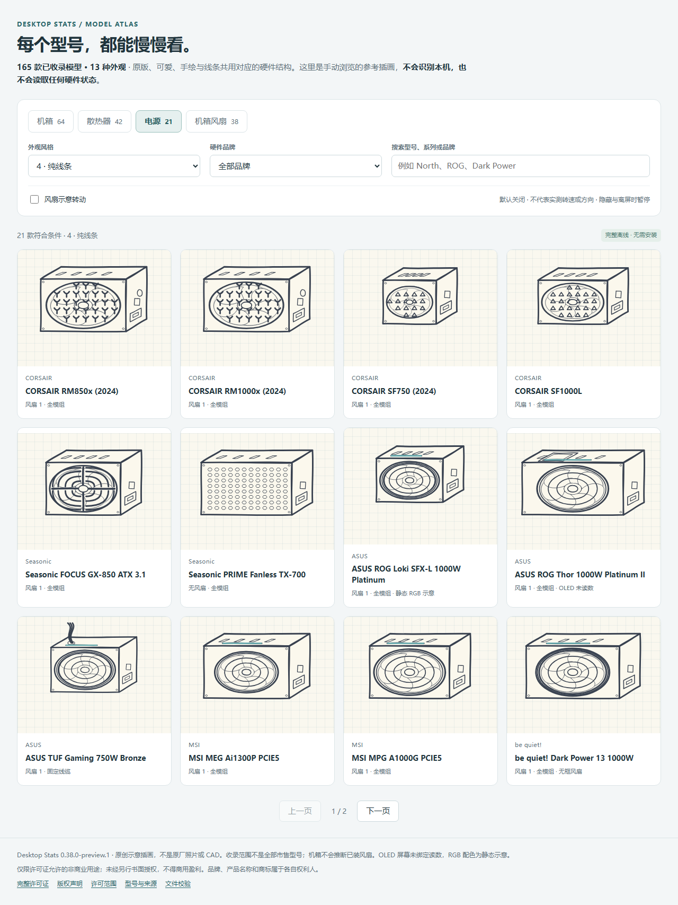

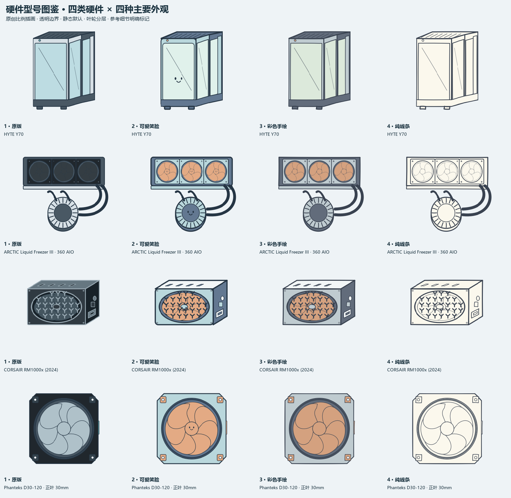

三维装配的风格选择与四类目录数量移到首屏，可直接打开风冷、水冷和自定义水冷示例。
示例保留已选 CPU、显卡和内存；参考配置不代表本机已安装这些配件。
**统一应用此风格** 可清除单个部件的独立风格覆盖。手绘与线条版修复叶轮、角垫和电源孔栅的断线，
保持原版实体几何及既有线段总量上限。

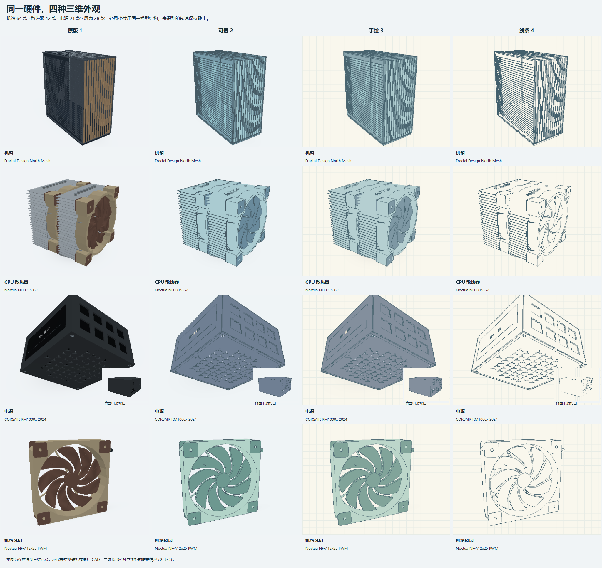

新增 **硬件扩展包**：Intel 与 AMD CPU 型号包可分别从 GitHub 下载、导入和移除。
本体保留原有 3 款 CPU，两个可选包补充 72 款，覆盖常见桌面、入门旧款与 Threadripper，
合计 75 款 CPU。它们使用 7 类共享封装，全部 13 套外观共用相同型号、形状和数量。
未核实的尺寸保留空值，采用明确标注的系列参考轮廓；不把每个同封装型号画成不同实物。
散热器扩至 66 套方案、风扇 70 个条目，包括无扇、薄型下压、异厚双塔、双层下压与冷排内泵等结构。

0.36 首批两个 CPU 扩展包合计约 **10 KB**（仅该历史批次）；程序仅保留型号索引和最多 8 个选中型号描述，
不预载整个型号库的三维模型，不增加目录轮询、传感器采集、后台线程或服务。
0.36 首版包格式仅支持 CPU；0.45 已增加风扇／散热器／冷排，机箱等其它类别仍需迁移。下载与导入方法、限制和非商用许可
见 [硬件扩展包说明](docs/HARDWARE_PACKS.md)。这是一批有来源的逐产品扩充，尚未覆盖市场所有产品。

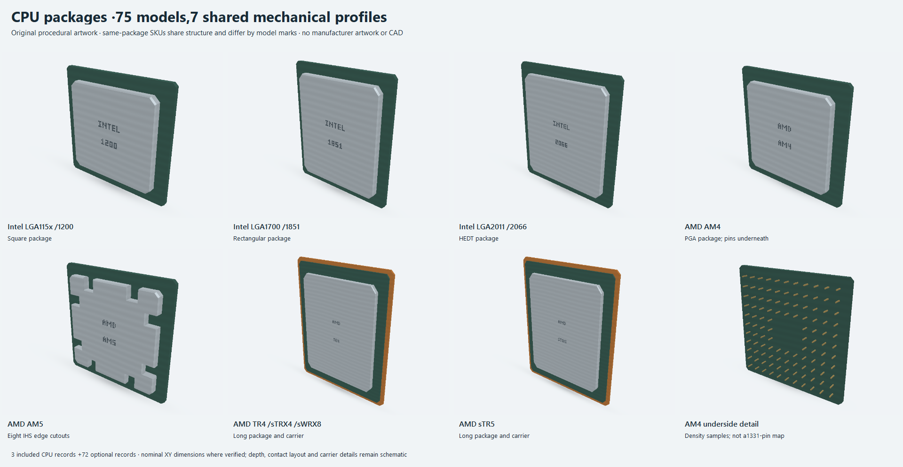

整机装配增加具体型号的主板、风冷与水冷散热器、机箱风扇、电源、存储及扩展卡。
CPU、显卡和每条内存可以独立选择参考型号；同一机箱内可逐类、逐件混搭十三套外观。
原版保持无表情，换风格保留部件数量、尺寸、安装方向和已核结构。
参考型号不绑定另一件硬件的温度、功耗或转速，未知型号继续明确标注。
当前目录和各型号资料状态见 [可选装配清单](docs/ASSEMBLY_CATALOG.json)，未覆盖全部市售产品。

三维模型继续细化：显卡改为有真实开孔的薄壳，分别绘制散热鳍片、PCB 边缘、
接口空腔与紧固件；内存按 DIMM 与 SO-DIMM 的安装方向区分，机箱增加倒角和细网孔。
已核实的主板与十二款机箱补充原厂接口数量，其余内部排布保持明确的比例示意。
模型提供 **简洁 / 精细 / 近看细节** 三档，按需生成，实时读数和短时特效不重建模型。
十三套风格各有不同的选中动效，播放后停止刷新；详见 [模型质量与特效说明](docs/ASSEMBLY_QUALITY.md)。

桌面小组件移除右下角可见的缩放斜线，仍可从角落调整大小。默认三指标卡片按主指标与
辅助指标排列；已自定义的位置、顺序与布局继续保留，不新增后台采样。

设置新增 **整机视图**：按需打开可旋转、缩放及展开的真实三维示意，分别查看整机、
显卡、CPU、内存和主板。核心外形复用本体 178 项目录，安装两个 CPU 包后共 250 项；机箱目录扩充至 **96 款、26 个品牌、
6 类结构**，尚未覆盖所有市售机箱。机箱型号可按品牌筛选并手动选择；自动匹配仅采用已验证的
固件标识，DIY 主机通常不提供机箱型号，不会从 ASUS 主板推断 ASUS 机箱。
当前目录还没有经过验证的零售机箱固件映射，识别不到时使用明确标注的参考机箱。
模型是原创比例示意，不是厂商 CAD 或安装兼容性保证；未知散热器、电源与机箱风扇
不按已安装部件绘制。三维视图默认静止；只有已匹配风扇使用自身新鲜有效 RPM 与既有共同动画时钟，
机箱／冷排／电源等未知测速保持静止，演示模式另行标注。隐藏、最小化或关闭时停止动效；
关闭后安排释放渲染资源，不能以关闭事件返回瞬间作为完全回收的证明。
见 [三维整机视图说明](docs/USER_GUIDE.md#三维整机视图0320-预览版)。

### 硬件外观清单：六版沿革与现有选项

旧记录中的“六版”确实存在：`6f567ee`（0.29）时的配置是 **经典通用、结构线稿、
精简实物、微缩实物、柔和双色、可爱卡通**，当时文档明确称可爱卡通为第六套。
之后加上手绘与其他方案；当前保存值共有 **13 个**，原六版全部保留。
历史文档遗留的“五种”说明已修正。这里的插画版本与组件的六种玻璃／卡片皮肤分别设置。

| 界面选项 | 保存值 | 沿革与保留规则 |
| --- | --- | --- |
| 经典通用 | `classic` | 原六版；顶部栏保留通用符号，桌面模型按具体硬件绘制 |
| 结构线稿 | `outline` | 原六版；保留早期描边，桌面模型保留具体结构 |
| 精简实物 | `solid` | 原六版；实体面板和明确的风扇井 |
| 1 · 原版 | `miniature` | 原六版的微缩实物；无笑脸，保留薄侧面 |
| 柔和双色 | `soft` | 原六版；柔和面板与同型号叶轮 |
| 2 · 可爱笑脸 | `cartoon` | 原六版的第六套；仅本套及笑脸手绘允许表情 |
| 手绘线稿 | `sketch` | 后增；独立手绘线条，保留型号结构 |
| 3 · 彩色手绘 | `notebook_color` | 后增；轻微歪斜笔迹和淡彩，无笑脸 |
| 4 · 纯线条 | `notebook_line` | 后增；留白线条，无笑脸 |
| 笑脸手绘 | `notebook_smile` | 后增；单独保留的手账笑脸方案 |
| 5 · 奶油贴纸 | `sticker` | 后增；无笑脸，不改硬件种类与数量 |
| 6 · 拼色剪纸 | `papercut` | 后增；无笑脸，不改硬件种类与数量 |
| 蓝墨手账（保留选项） | `inkwash` | 后增；无笑脸，不改硬件种类与数量 |

当前固定展示编号仅 1–6；蓝墨手账等其余七项保留为历史选项，不新增编号或外观方案。
新增型号只维护一份识别与结构目录，各风格共用；切换时不重选设备、不改转速和温度来源。

现在固定展示的六套为 **原版（无表情的微型实物）、可爱笑脸、彩色手绘、纯线条、奶油贴纸、拼色剪纸**，覆盖本体及已安装包的相同硬件条目。
笑脸只属于单独的可爱外观；原版保留加笑脸前的图形，额外旧样式仍可选择。
另有 **奶油贴纸、拼色剪纸、蓝墨手账** 三套无表情的可选方案。每套都共用原版的完整型号目录：
147 个显卡、28 个内存、3 个基础 CPU（可选包再补 72 个）；仅改变插画表现，不删减硬件或改变自动识别、转速和读数。
这些数量表示当前已收录目录，后续扩充型号时，各方案同步使用更新后的目录。
按已核型号保留显卡外壳、风扇结构、CPU 封装和内存条形态，旧外观与已有选择继续保留。
图标和叶轮按需生成后复用，动效共用原有时钟，不增加硬件采样或后台服务。
CPU 温度成功恢复后同步更新启动状态；只切换图标不需要重启温度桥接。

顶部栏设置只保留一个实时预览，**内容与排列** 调整指标和顺序，**外观** 选择
整体设计、材质与连续透明度。桌面组件列表只在编辑桌面时显示；保存状态和待应用
更改在页底明确提示，原有布局、图标及版本 12 动效继续保留。

硬件详情先呈现当前读数与趋势，再按需显示 **占用最多的软件**。CPU、内存、GPU
和专用显存支持前五名排行；CPU 的逻辑处理器网格可展开，来源与限制另行查看。
顶部栏排行仅在详情及排行区域可见时采集，离开即停止，不写入历史或设置。

全屏游戏或应用位于前台时，顶部栏和详情自动避让，回到普通桌面后恢复。
设置隐藏或最小化时暂停预览动画、历史页查询和额外来源检查，保留草稿与滚动位置；
常规采样继续使用已保存的间隔，不通过缩短采样来改善视觉效果。

CPU 温度取决于机器实际提供的来源。本机 ASUS 适配使用可选的**只读会话桥接**，
需要已有 ASUS 服务及明确的管理员授权，随当前应用退出，不安装驱动或服务。
可在偏好中开启 **启动时恢复 CPU 温度**（默认关闭）：每次启动确认一次管理员授权，
全屏游戏时延后到回桌面；取消后本次会话不再提示。桥接本身不设开机启动，
不支持的机器或失效读数会显示原因。
见 [CPU 温度桥接说明](docs/USER_GUIDE.md#asus-cpu-temperature-bridge)。

[使用指南](docs/USER_GUIDE.md) 介绍布局、历史和数据来源；
[视觉指南](VISUAL-GUIDE.md) 展示可选动效；历次修改见 [变更记录](CHANGELOG.md)。

原创应用代码采用 [PolyForm Noncommercial 1.0.0](LICENSE)。未经另行书面授权，
不授予商业使用、商业集成或转售的权利。第三方依赖和旧版 MIT 权利保留，
详见 [许可范围](LICENSING.md)。公开仓库可被下载，许可证不提供技术防复制功能。

## 界面预览

以下是原生界面的离屏绘制图，全部使用合成示例数据。点击图片可查看高清原图；
图片不作为 Windows 原生磨砂外观的验收。

### 三维整机示意

参考装机可分别选择配件，并在同一机箱内混搭外观：

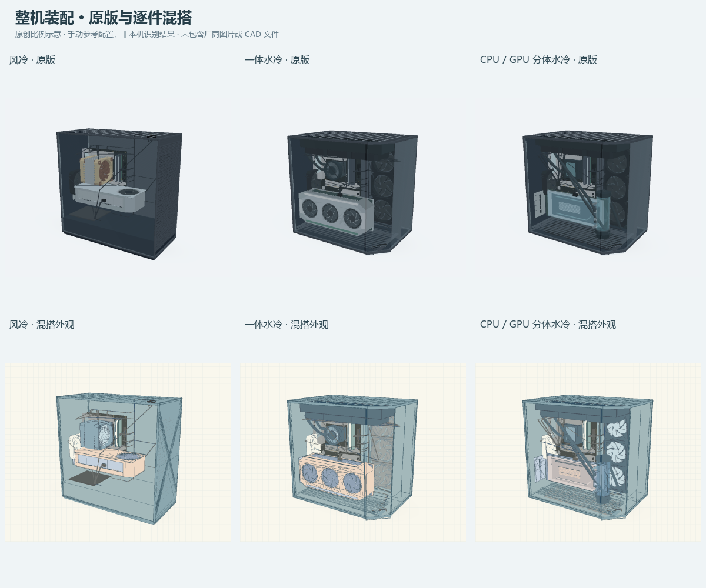

下方历史图只展示前四套外观；当前固定编号仍为六套，其余七个保存选项保留。所有画法共享相同硬件和装配：

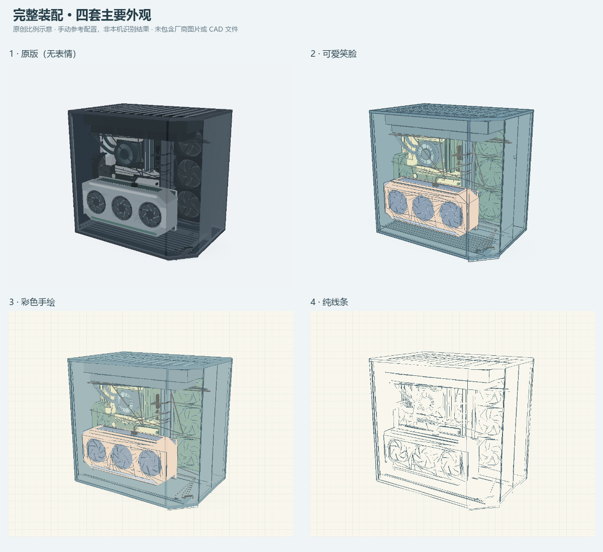

新版的显卡开孔、鳍片、接口、CPU 封装、内存和主板细节：

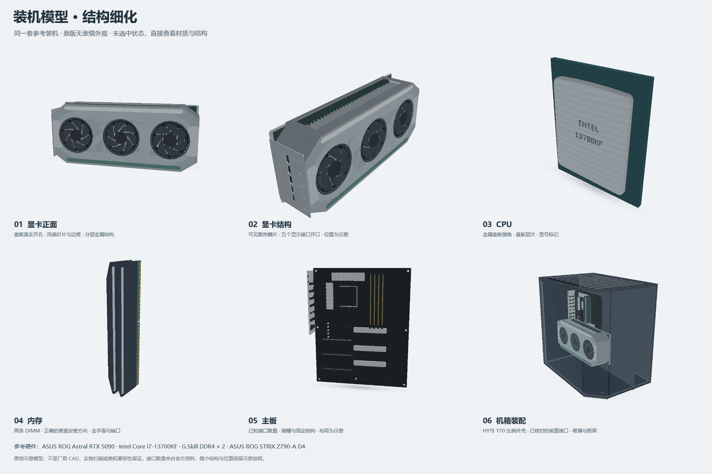

下方历史动图展示前四套短时特效，不改变当前六套编号；[查看全部十三套效果视频](assets/showcase/assembly-effects.mp4)。

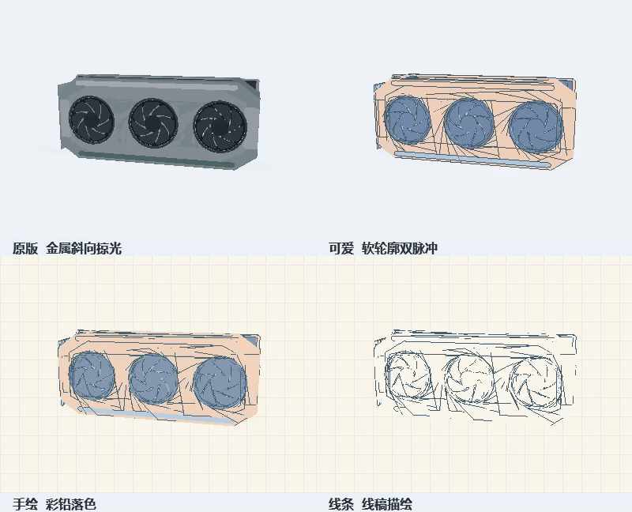

0.33.0-preview.1 新增 40 款，包括 O11 Vision、LANCOOL III/207、H7/H9 Flow、
5000D/7000D/2500X、North XL、Meshify 2、Helios、AP201、MasterFrame 700、
Core P3、Tower 200/600、NV5、D41/N4/TK-2、CH160/CH560/CH780、FLUX、
AIR 903/XR、ALTA G1M/SG13、A1 Prime/Chopin MAX 等型号。
保留玻璃顶、实心静音顶、开放框架、木饰框和提手等区别。尺寸及限制随具体型号记录；
Chopin MAX 无独立显卡安装位，N4 仅支持半高扩展卡，不会缩小硬件来伪装兼容。

机箱与内部组件默认跟随顶部栏硬件风格，也可在整机视图中独立选择相同的 13 套方案。
同一机箱的外尺寸、面板和硬件结构保持不变，配色、描边与手绘线条随方案切换。
原版保持无表情；笑脸只属于可爱笑脸和笑脸手绘。风扇沿用同一转速反馈，动效默认关闭。

<details><summary>查看全部 13 套机箱风格</summary>

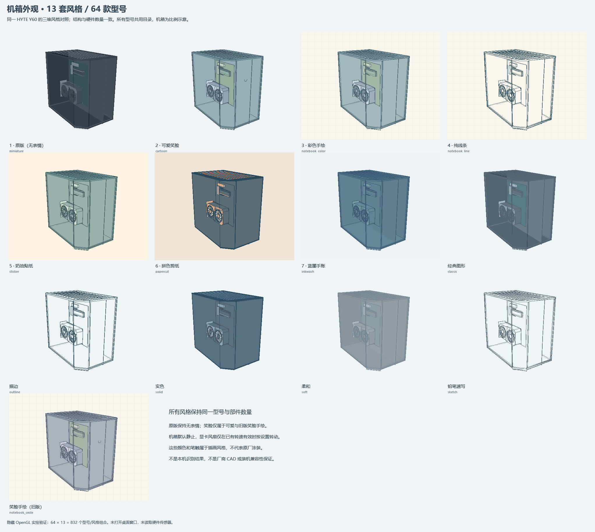

</details>

托盘菜单的 **桌面 3D 检视** 可直接打开独立检视器。拖动旋转，点击 CPU、显卡、
内存、主板或机箱选择部件，在状态面板查看现有实时读数或型号信息；选择不会使
整个机箱消失，也不会新增硬件采样。局部视图仍可单独放大部件，关闭后释放图形资源。

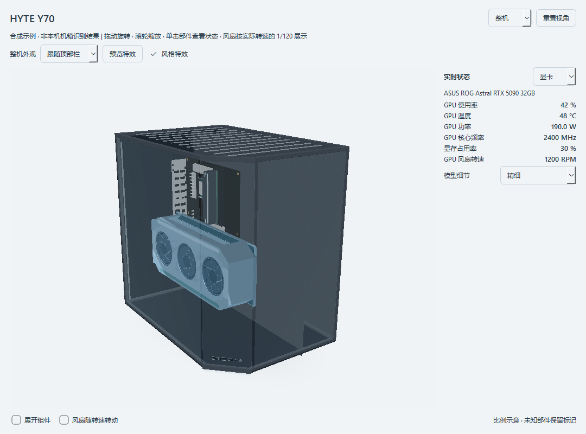

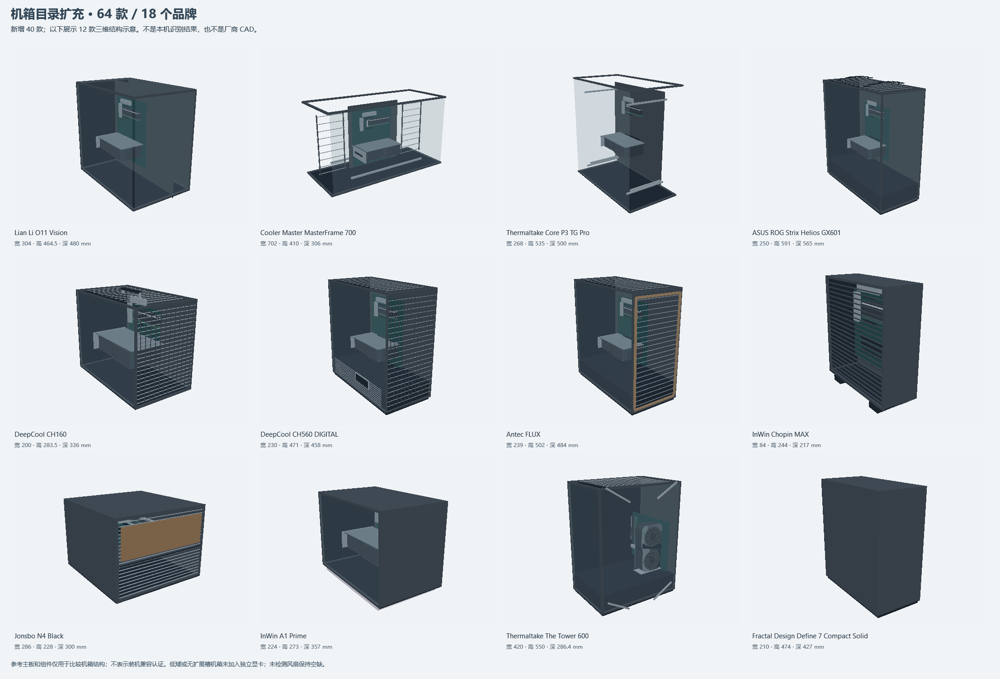

以下使用合成组件展示五类机箱结构，不代表本机识别结果，也不是厂商 CAD。
三维视图按需打开，默认静止，型号与尺寸仍需按实物核对。

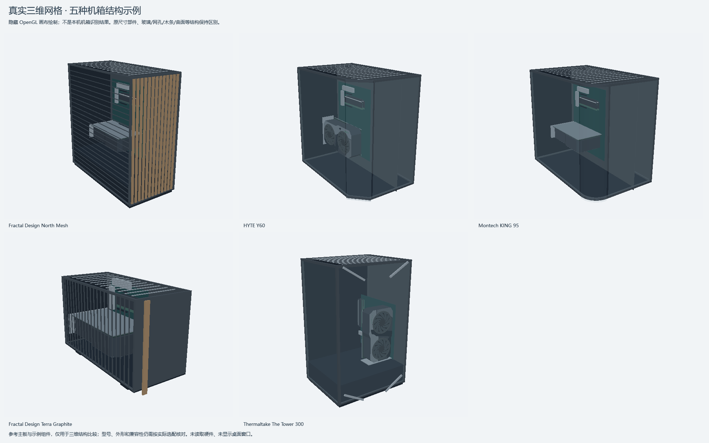

### 历史七样式对照图（不代表当前展示编号）

[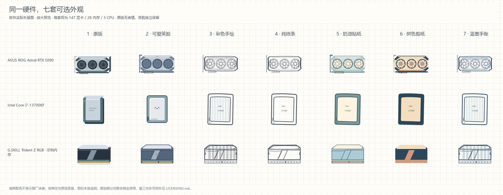](assets/showcase/hardware-schemes.png)

这张历史图使用当时的 178 项型号目录，保留风扇数量、结构和内存缺口；不是当前完整硬件覆盖量，也不新增编号。图中配色属于插画方案，
不表示原厂漆色或 RGB 状态；新增方案不会替换已保存的原版。原创插画的使用须遵守上方非商业声明。

### 读数更新，动画继续

[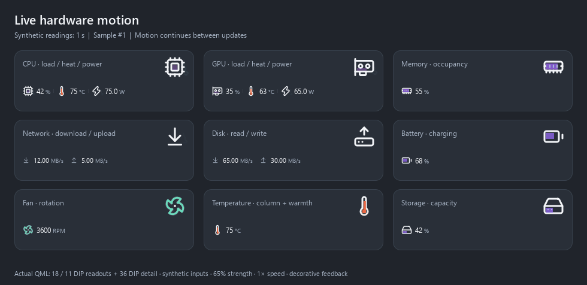](assets/showcase/motion-continuity-dark.gif)

每秒改变一次合成读数，动画在读数之间继续运行。上图展示实际大小的读数图标与 36 DIP 细节参考，
强度 65%、速度 1×；GIF 为 20 fps 的离屏演示，并非实际电脑帧率测试。
[查看浅色演示](assets/showcase/motion-continuity-light.gif) · [完整视觉指南](VISUAL-GUIDE.md)

### 三套顶部栏设计

[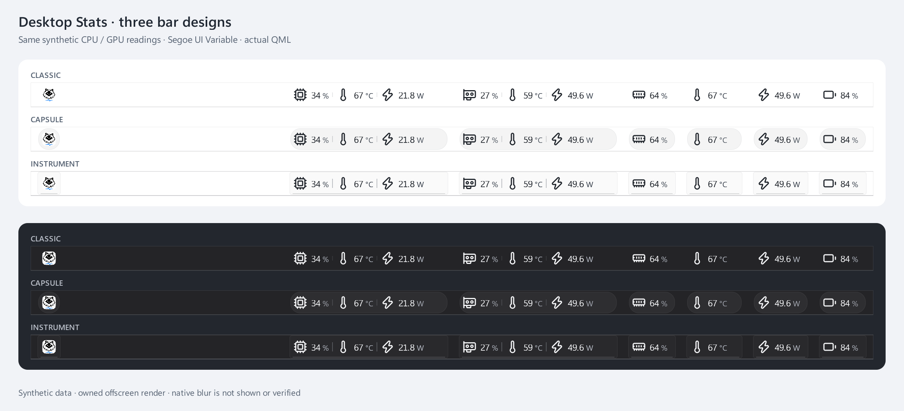](assets/showcase/top-bar-designs.png)

在 **外观** 中选择经典菜单栏、分组胶囊或精密仪表，共用同一个实时预览，保留指标、组合、单位与设备设置。

可选图标动效默认关闭。开启后，CPU/GPU 的温度驱动黄橙红电弧，功耗驱动蓝白电流；短电弧在不同位置闪出、分叉、熄灭。独立温度计使用温柱和黄红热晕，不显示电流；风扇平滑旋转。强度与速度连续调节，缺测、零活动和减少动画时静止。

选择 **图标动效 → 硬件联动** 可让同一图标显示独立的硬件通道：CPU/GPU 的负载、黄红热感与蓝色功耗反馈可以同时出现，网络和电池分别处理两个方向。电弧在十个视觉阶段之间连续过渡，逐渐增加伸展幅度、放电频率和同时出现的细丝；真实数值不分档。内存没有温度传感器时不编造发热，NVMe 损耗也不会被当成负载。

[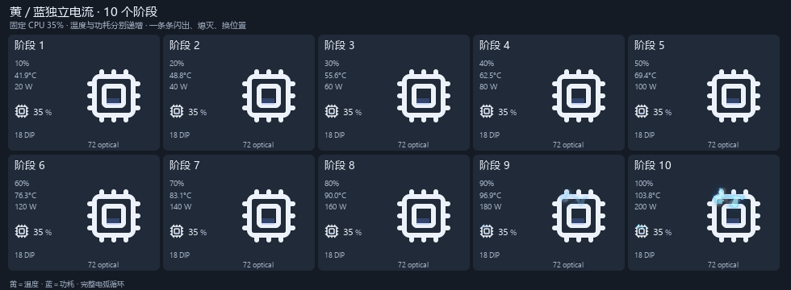](assets/showcase/hardware-motion-dark.gif)

动画使用合成示例读数；[查看浅色动画](assets/showcase/hardware-motion-light.gif)。电弧为状态装饰，不代表检测到了物理放电。

| 硬件联动 · 浅色 | 硬件联动 · 深色 |
| --- | --- |
| [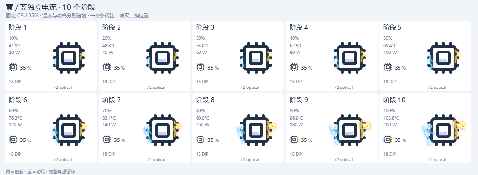](assets/showcase/hardware-feedback-light.png) | [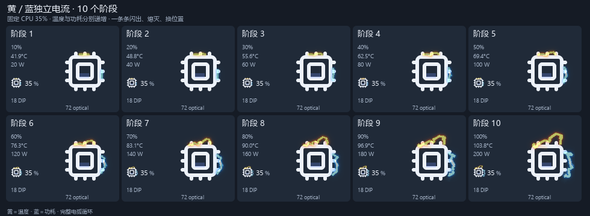](assets/showcase/hardware-feedback-dark.png) |
| 真实控制器投影的合成数据，保留实际图标大小。 | 独立通道可以叠加，静态图只能展示一个动画时刻。 |

### 硬件详情与指标编辑

[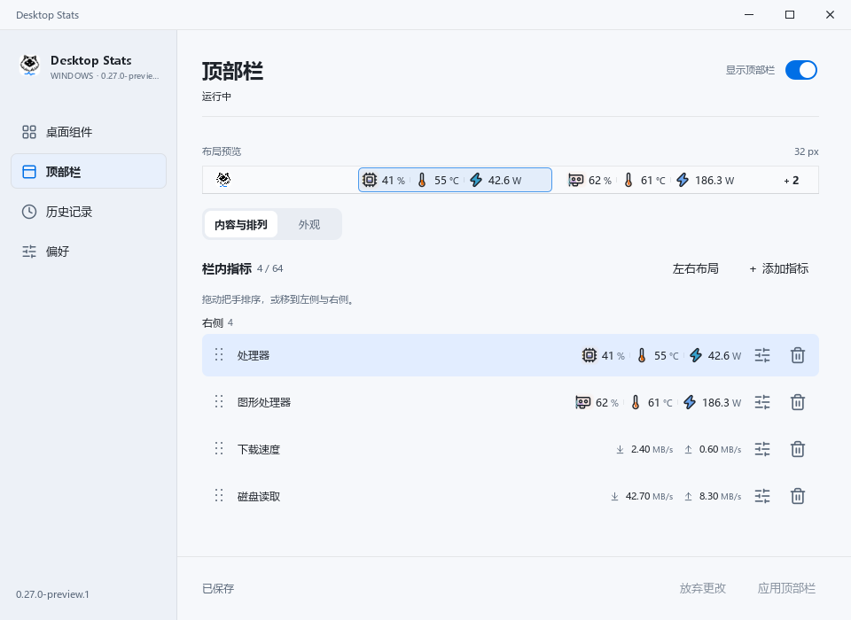](assets/showcase/top-bar-actions.png)

每项右侧直接调整或删除，组合编辑先暂存，再确认；可选图标动效默认关闭。

| CPU：读数、趋势与软件排行 | 组合：明确确认与取消 |
| --- | --- |
| [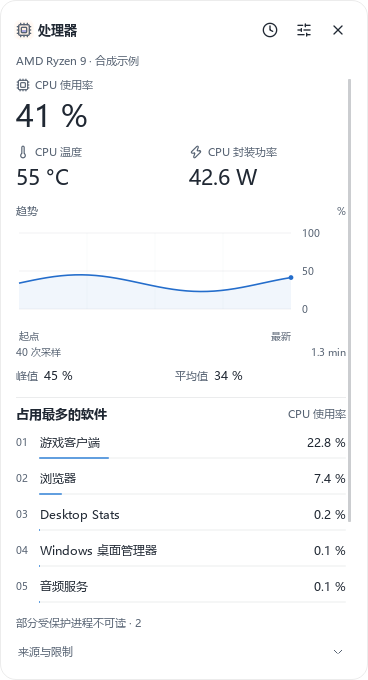](assets/showcase/cpu-details.png) | [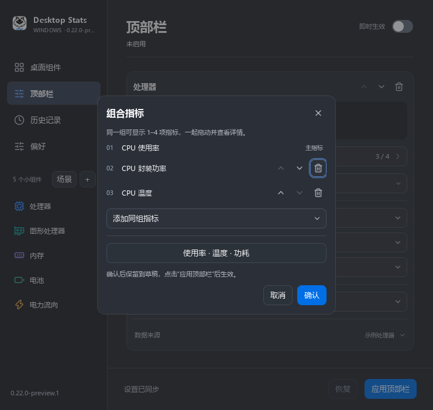](assets/showcase/group-confirm.png) |
| 逻辑处理器按需展开；缺测与零值明确区分，不编造每核温度或功耗。 | 取消不提交，确认后保留到草稿，再应用顶部栏。 |

双向网络详情保留上下行、真实缺口、共同量程及逐点读数：[查看高清预览](assets/showcase/network-details.png)。

### CPU / GPU 组合读数

[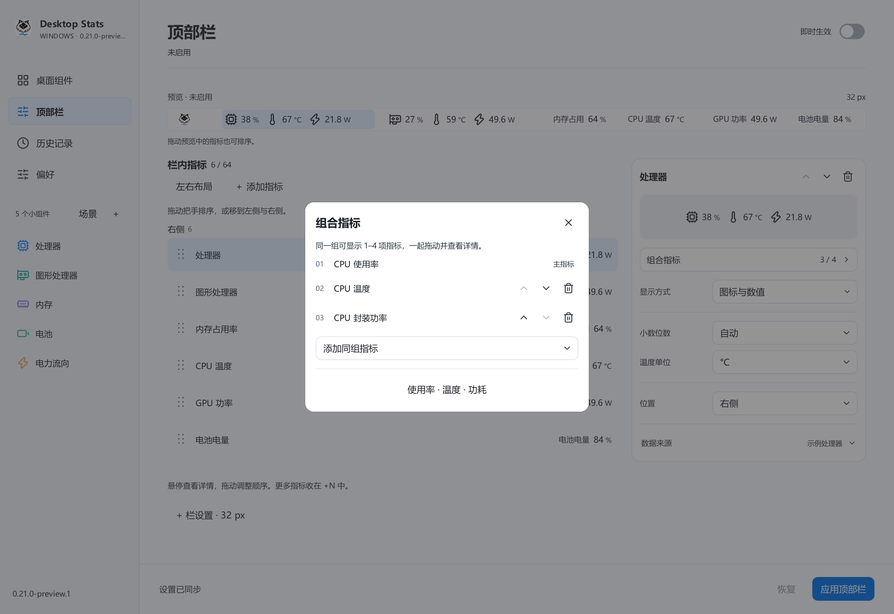](assets/showcase/top-bar-groups.png)

使用率、温度和功耗放在同一组，整组拖动；组内内容与顺序可调整。原有单项样式保留。

| 组件编辑与实时预览 | 顶部栏：屏幕、指标与显示样式 |
| --- | --- |
| [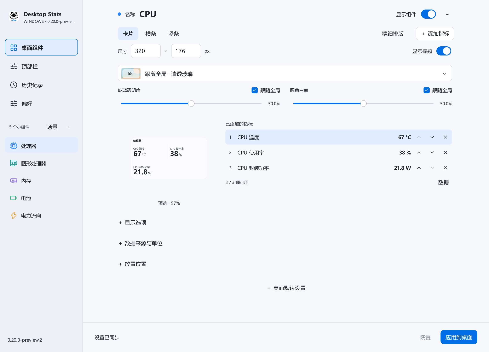](assets/showcase/widgets-editor.png) | [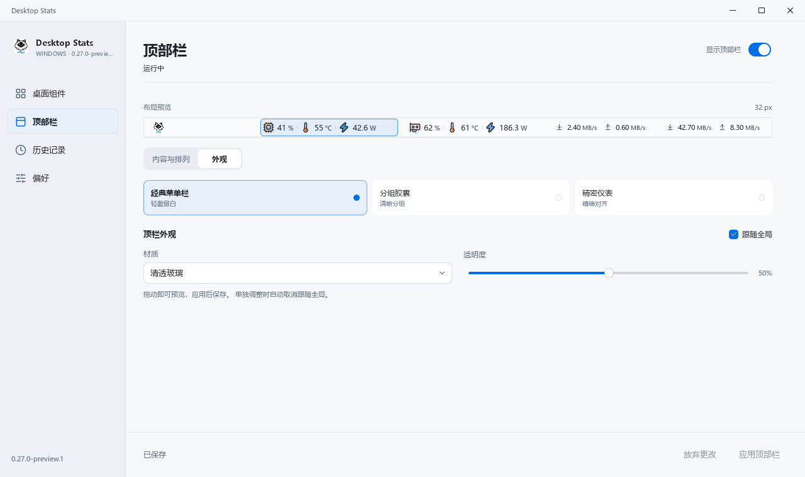](assets/showcase/top-bar-styles.png) |
| 自适应布局与精细排版，按需调整组件内容。 | 选择显示器、排列指标，网络上下行支持同框。 |

| 历史趋势 · 浅色 | 历史趋势 · 深色 |
| --- | --- |
| [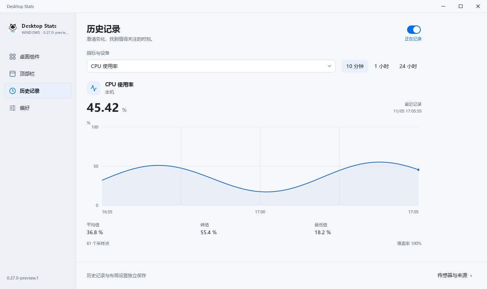](assets/showcase/history-light.png) | [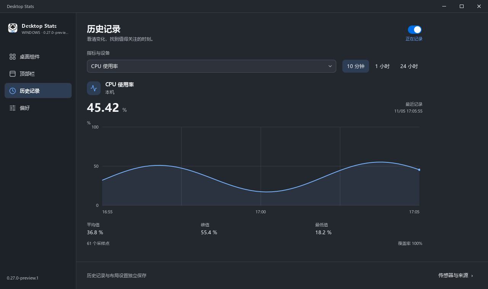](assets/showcase/history-dark.png) |
| 查看时间走势、范围和记录状态。 | 悬停或使用方向键查看具体时间和读数。 |

| 场景：先预览，再应用 | 来源诊断：原因与下一步 |
| --- | --- |
| [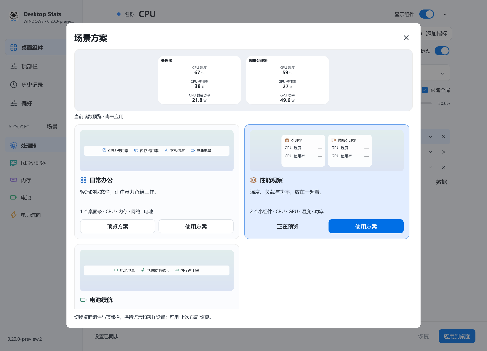](assets/showcase/scene-preview.png) | [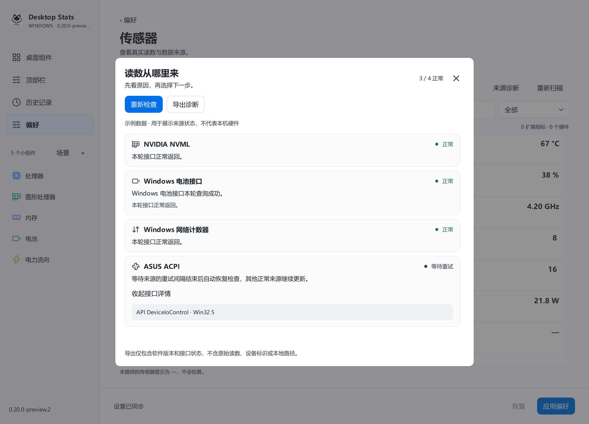](assets/showcase/source-diagnostics.png) |
| 内置方案、自存布局与上次布局恢复。 | 分开显示来源状态，接口详情按需展开。 |

## 功能

- 桌面卡片、横条、竖条；组合或独立显示，支持自适应布局、拖动排序与对齐吸附。
- 多屏顶部栏；按需选择指标、显示样式、位置和单位，悬停查看详情。
- 顶部栏以单一实时预览连接“内容与排列”和“外观”，支持三套整体设计与连续透明度。
- CPU 与 GPU 支持组合读数：同一格放入最多四项指标，整组拖排，组内可调整内容和顺序。
- CPU 详情可展开逻辑处理器使用率，关联频率、温度、功耗与风扇读数；CPU、内存、GPU、显存及软件读写 I/O 的 Top 5 排行按需采集。I/O 含缓存与设备，不是当前物理磁盘统计，网络逐进程排行仍缺。
- 指标行右侧直接调整或删除；组合编辑可确认或取消。图标动效按项选择，强度和速度连续可调，默认关闭，并遵循系统减少动画设置。
- 动效围绕图标局部结构呈现，保留清晰的静态轮廓；彩色细节和节奏随真实读数平滑变化，不作为告警或标定转速。详情按当前读数、真实趋势、软件排行和可展开核心明细排列。自动切换网卡或系统卷后，图表仍只显示当前设备的历史，不混入其他设备。
- 网络上下行、磁盘读写、电池充放电支持同框显示。
- 六种皮肤、连续透明度和圆角、可选标题与图表；全局默认和单组件设置独立。
- CPU、GPU、内存、电池、网络、磁盘与部分温度、功率、风扇读数。
  每项数据保留来源与不可用原因，不把缺测显示为零。
- 设置分区保存，支持撤销、导入导出、多语言及 0.01–5 秒请求采样间隔。
- 本机历史记录，支持 10 分钟、1 小时与 24 小时查看；折线保留缺测，聚合保留峰值范围。
- 日常办公、性能观察、续航场景，以及自存布局和上次布局恢复；先预览再应用。
- 来源诊断先显示原因和下一步，接口错误按需展开；支持重新检查与脱敏导出。

使用随硬件而异。普通电脑不一定提供整机输入功率或噪声传感器；本软件不从
CPU/GPU 功率推算整机功率，不从风扇转速编造分贝。更快的请求间隔不保证硬件
以同样频率返回新读数。Windows 透明效果、系统策略及显示驱动可能影响玻璃效果。

## 安装与使用

公开预览目前提供经过检查的源码快照，Windows 安装包暂未发布。

解压 Windows 发布包，保留 `DesktopStats.exe` 与 `_internal` 在同一目录，运行
`Install.cmd`。源码包不能直接当作安装包使用。托盘图标可打开设置或退出程序。
升级前先应用或撤销未保存设置，安装程序会保留可恢复的旧安装备份。

在“桌面组件”按 **＋** 添加模板；只用上方栏时可关闭全部桌面组件。已保存为仅顶部栏
的配置首次打开设置会直接进入顶部栏页。**内容与排列** 调整指标，**外观** 调整样式；
“应用”或“放弃更改”只处理当前区域。更多操作、传感器来源与限制见 [使用和开发说明](docs/USER_GUIDE.md)。

“历史记录”可独立暂停和清空，数据仅保存在本机。按来源原始时间戳记录；普通写盘
采用五秒批次门槛，两秒采样时约六秒一次，实时查询包含未提交尾部；不把重复读取的
缓存当作新的硬件样本。暂停记录或正常退出时尝试保存尾部。

## 开发与检查

Python 3.12、Windows x64：

```powershell
python -m venv .venv
.\.venv\Scripts\python.exe -m pip install -r requirements-build.txt
.\.venv\Scripts\python.exe tools\fetch_sensor_dependencies.py
.\.venv\Scripts\python.exe tools\build_collector.py --self-test
.\.venv\Scripts\python.exe tools\test_isolated.py
.\.venv\Scripts\python.exe tools\export_source.py
```

检查使用独立数据目录和离屏绘制，不操作鼠标、不打开桌面测试窗，也不改正在运行
的软件配置。离屏检查只能验证布局与交互，不能证明原生 Windows 磨砂效果。
源码导出按白名单包含当前快照和文件校验清单，不包含旧版本程序、私人配置或日志。
源码快照不携带第三方 DLL 或采集器 EXE。依赖准备工具只从固定的官方发布获取
经校验的九个库，不执行下载内容；随后由本机编译原创采集器。构建需要已有的
Windows .NET Framework 编译器；脚本不会自动安装驱动或 SDK。
打包与依赖重建步骤见 [开发说明](docs/USER_GUIDE.md#develop-verify-and-build)。

电弧图集已经包含在源码中，正常运行和打包无需重新生成。需要修改动效素材时，
另行安装 `requirements-artwork.txt`，运行
`python tools/generate_metric_motion.py --output assets/metric-motion-new`。
生成器写入新的项目内目录，保留现有素材和清单；使用新资源前核对生成参数、
实际小尺寸动画和哈希。Three 算法署名与 MIT 例外见第三方说明。

The application runs locally with Python/PySide6. The packaged build needs no
browser, Rainmeter, Python installation or cloud login. Original application code
is source-available under PolyForm Noncommercial 1.0.0; this is not an
OSI-approved open-source license. Third-party notices and LGPL library replacement
rights remain intact. See [LICENSING.md](LICENSING.md),
[third-party notices](THIRD_PARTY_NOTICES.md) and [changes](CHANGELOG.md).
