# 年糕 · Desktop Stats for Windows

<p align="center"></p>

可自由组合的原生 Windows 桌面监控组件与顶部状态栏。选择自己需要的指标，
用卡片、横条或竖条显示；悬停顶部栏可展开图表、设备和数据来源。

**0.26.0-preview.4 · 开发预览 · Windows x64 · 仅允许许可规定的非商业用途**

本版让组合、双向读数和设置预览保留动画实例：新读数只更新目标，不再重建图标和重置相位。
保留上一版的顶部栏详情修复、采样频率和布局。风扇高速时旋转更明显；
支持采集库实际提供的噪声 dBA 通道。安装版可固定配置位置，避免不同启动方式显示成默认文字布局。

风扇现在按绘制帧推进，偶发慢帧下限制旋转跳步；其余特效保持独立节奏。
没有活动风扇时使用原有的低频共享时钟，隐藏、停转或减少动画时停止相应动效。

[视觉效果与使用指南](VISUAL-GUIDE.md) 包含开启动效的方法、不同硬件的表现、整体样式、
皮肤说明和可重现的动态演示。

原创应用代码采用 [PolyForm Noncommercial 1.0.0](LICENSE)。未经另行书面授权，
不授予商业使用、商业集成或转售的权利。第三方依赖和旧版 MIT 权利保留，
详见 [许可范围](LICENSING.md)。公开仓库可被下载，许可证不提供技术防复制功能。

## 界面预览

以下是原生界面的离屏绘制图，全部使用合成示例数据。点击图片可查看高清原图；
图片不作为 Windows 原生磨砂外观的验收。

### 读数更新，动画继续

[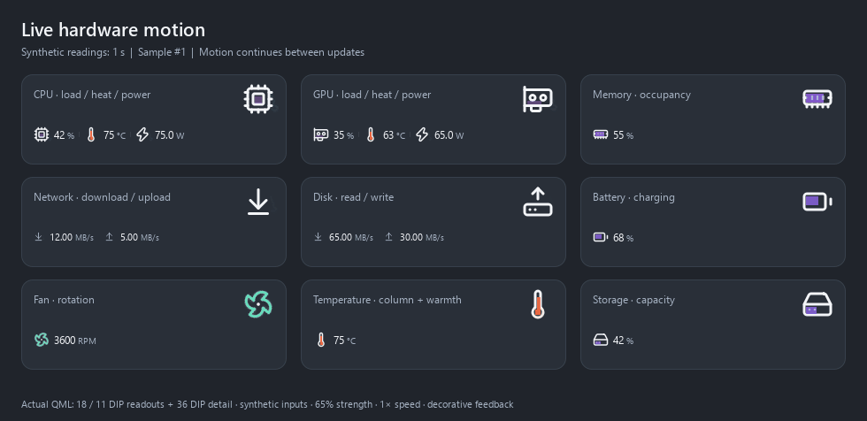](assets/showcase/motion-continuity-dark.gif)

每秒改变一次合成读数，动画在读数之间继续运行。上图展示实际大小的读数图标与 36 DIP 细节参考，
强度 65%、速度 1×；GIF 为 20 fps 的离屏演示，并非实际电脑帧率测试。
[查看浅色演示](assets/showcase/motion-continuity-light.gif) · [完整视觉指南](VISUAL-GUIDE.md)

### 新增：三套完整顶部栏设计

[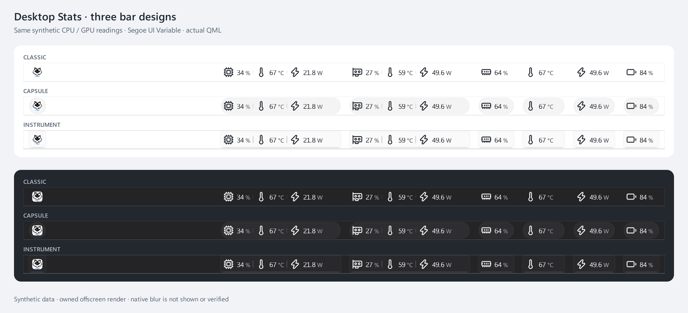](assets/showcase/top-bar-designs.png)

经典菜单栏、分组胶囊和精密仪表共享完整指标、组合和拖动操作；预览直接选择，单位和设备保持原设置。

[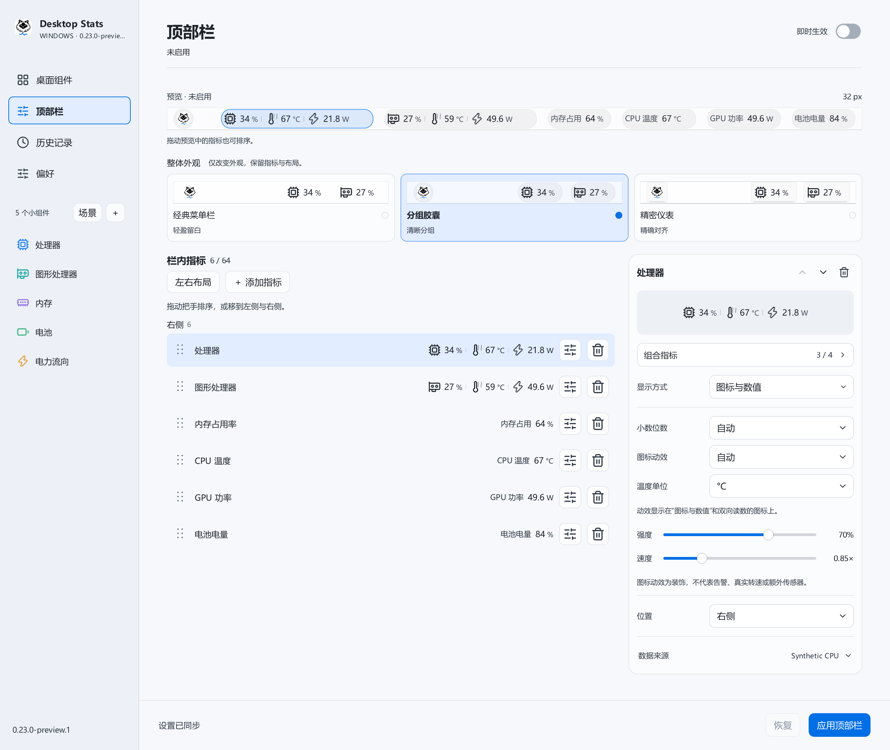](assets/showcase/top-bar-design-settings.png)

可选图标动效默认关闭。开启后，CPU/GPU 的温度驱动黄橙红电弧，功耗驱动蓝白电流；短电弧在不同位置闪出、分叉、熄灭。独立温度计使用温柱和黄红热晕，不显示电流；风扇平滑旋转。强度与速度连续调节，缺测、零活动和减少动画时静止。

选择 **图标动效 → 硬件联动** 可让同一图标显示独立的硬件通道：CPU/GPU 的负载、黄红热感与蓝色功耗反馈可以同时出现，网络和电池分别处理两个方向。电弧在十个视觉阶段之间连续过渡，逐渐增加伸展幅度、放电频率和同时出现的细丝；真实数值不分档。内存没有温度传感器时不编造发热，NVMe 损耗也不会被当成负载。

[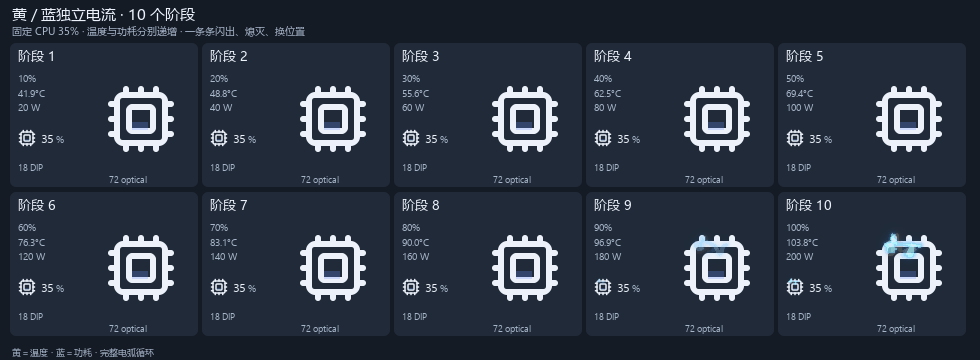](assets/showcase/hardware-motion-dark.gif)

动画使用合成示例读数；[查看浅色动画](assets/showcase/hardware-motion-light.gif)。电弧为状态装饰，不代表检测到了物理放电。

| 硬件联动 · 浅色 | 硬件联动 · 深色 |
| --- | --- |
| [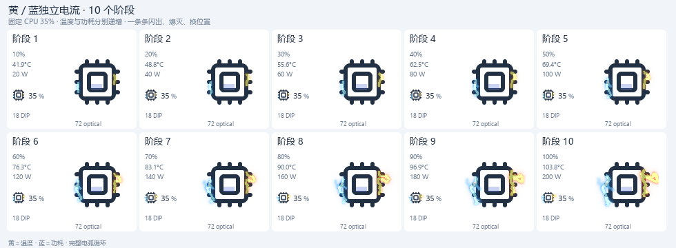](assets/showcase/hardware-feedback-light.png) | [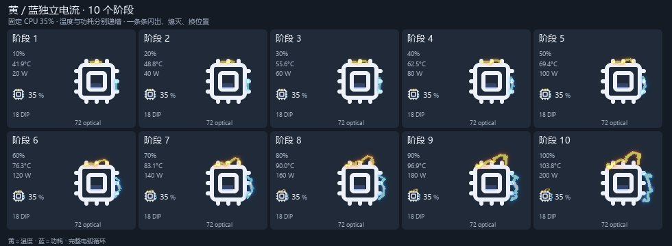](assets/showcase/hardware-feedback-dark.png) |
| 真实控制器投影的合成数据，保留实际图标大小。 | 独立通道可以叠加，静态图只能展示一个动画时刻。 |

### 新增：CPU 详情与清楚的操作

[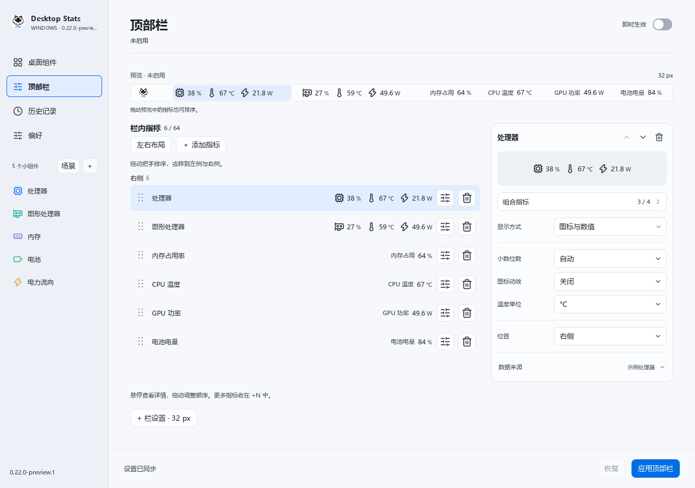](assets/showcase/top-bar-actions.png)

每项右侧直接调整或删除，组合编辑先暂存，再确认；可选图标动效默认关闭。

| CPU：逐逻辑处理器与关联读数 | 组合：明确确认与取消 |
| --- | --- |
| [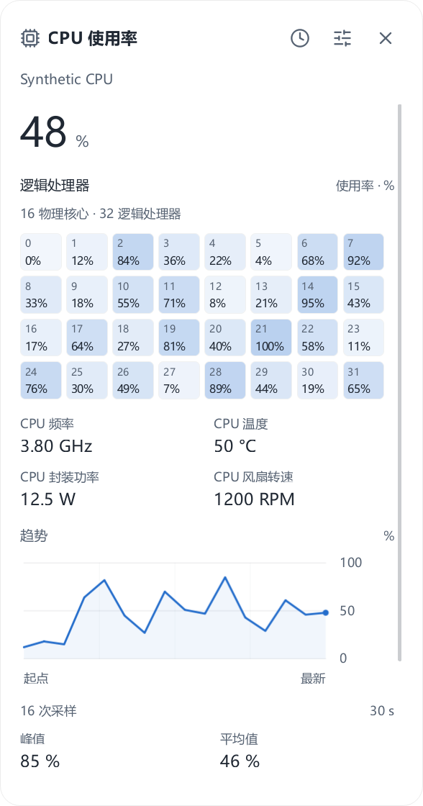](assets/showcase/cpu-details.png) | [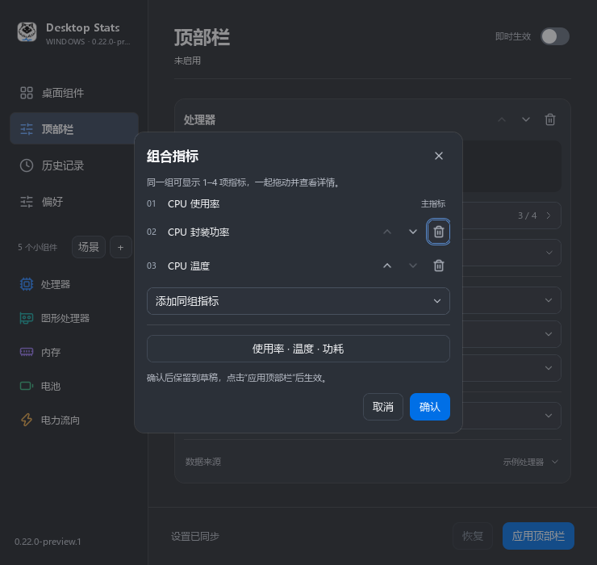](assets/showcase/group-confirm.png) |
| 逐项保留缺测与零值，不编造每核温度或功耗。 | 取消不提交，确认后保留到草稿，再应用顶部栏。 |

双向网络详情保留上下行、真实缺口、共同量程及逐点读数：[查看高清预览](assets/showcase/network-details.png)。

### CPU / GPU 组合读数

[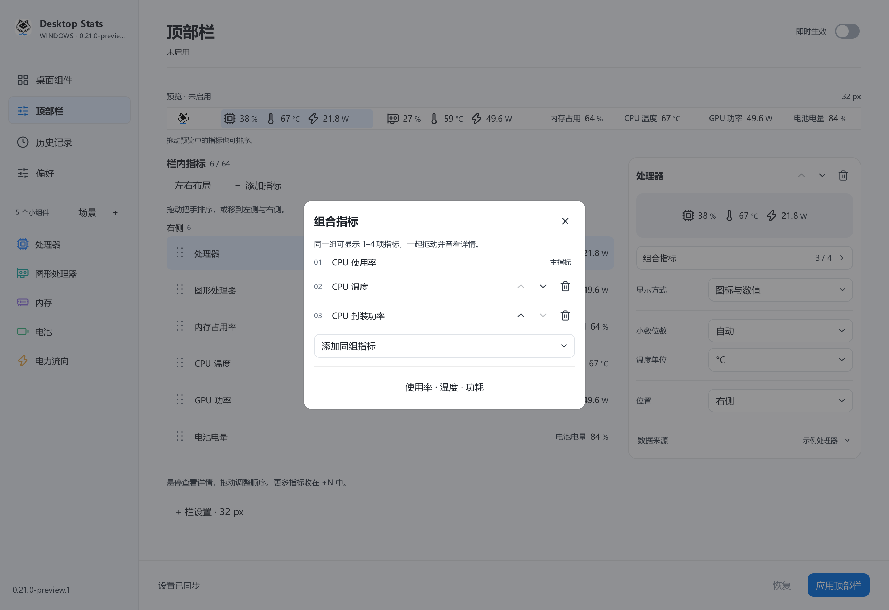](assets/showcase/top-bar-groups.png)

使用率、温度和功耗放在同一组，整组拖动；组内内容与顺序可调整。原有单项样式保留。

| 组件编辑与实时预览 | 顶部栏：屏幕、指标与显示样式 |
| --- | --- |
| [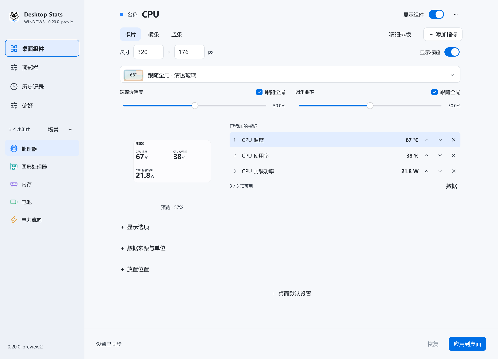](assets/showcase/widgets-editor.png) | [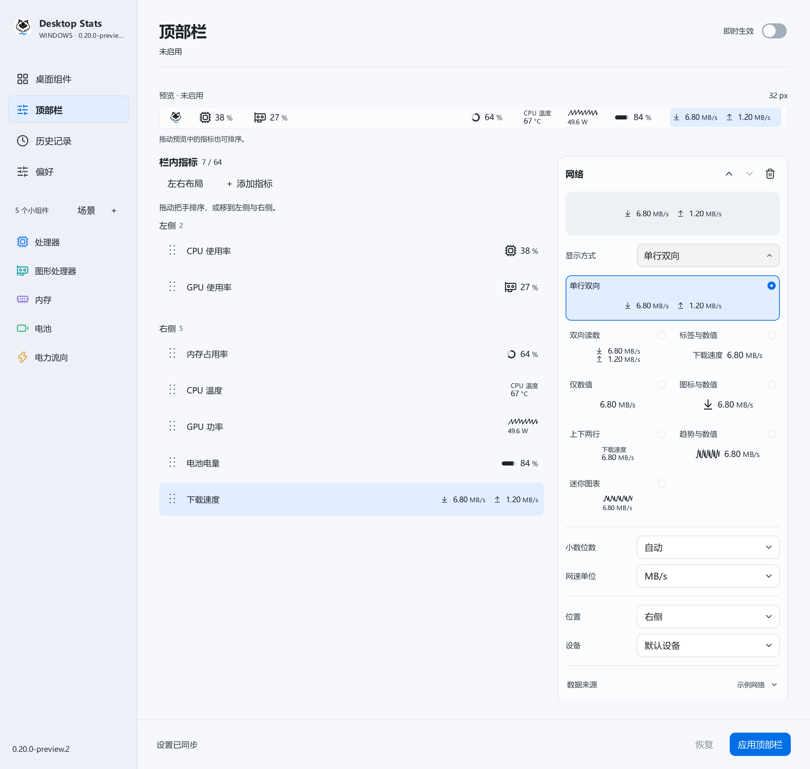](assets/showcase/top-bar-styles.png) |
| 自适应布局与精细排版，按需调整组件内容。 | 选择显示器、排列指标，网络上下行支持同框。 |

| 历史趋势 · 浅色 | 历史趋势 · 深色 |
| --- | --- |
| [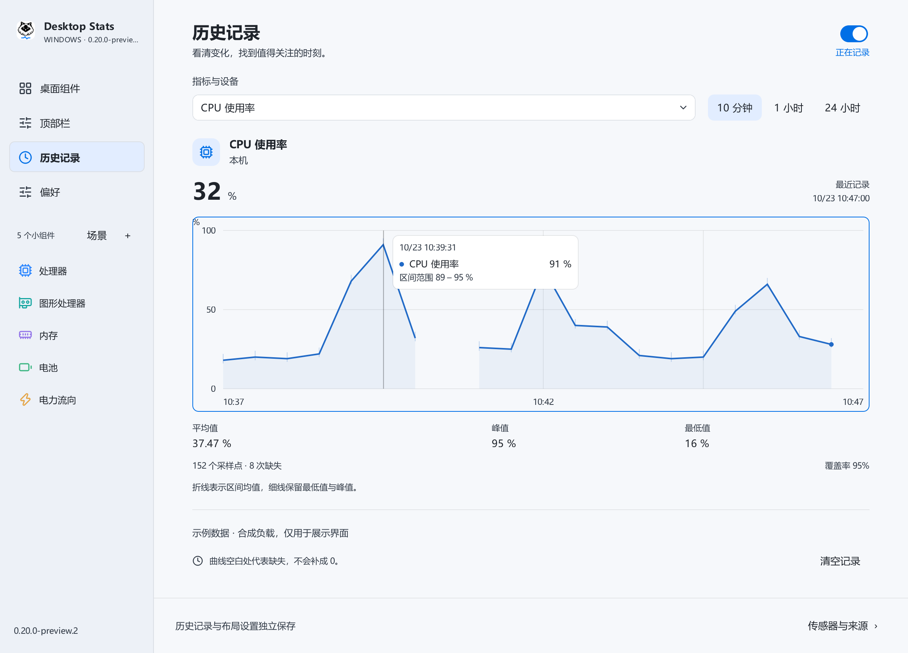](assets/showcase/history-light.png) | [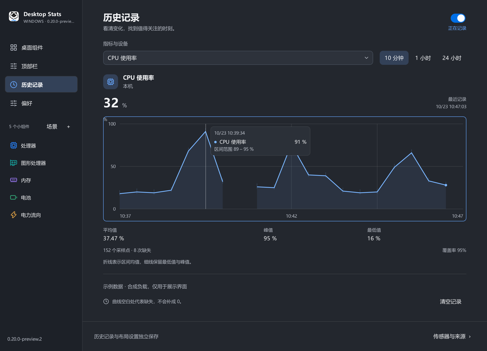](assets/showcase/history-dark.png) |
| 固定时间分组，保留真实的缺测和峰谷范围。 | 悬停或使用方向键查看具体时间和读数。 |

| 场景：先预览，再应用 | 来源诊断：原因与下一步 |
| --- | --- |
| [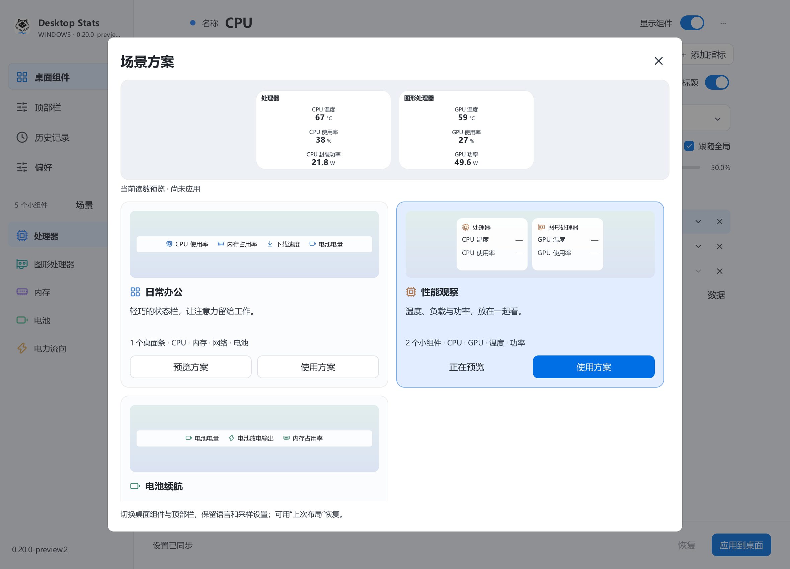](assets/showcase/scene-preview.png) | [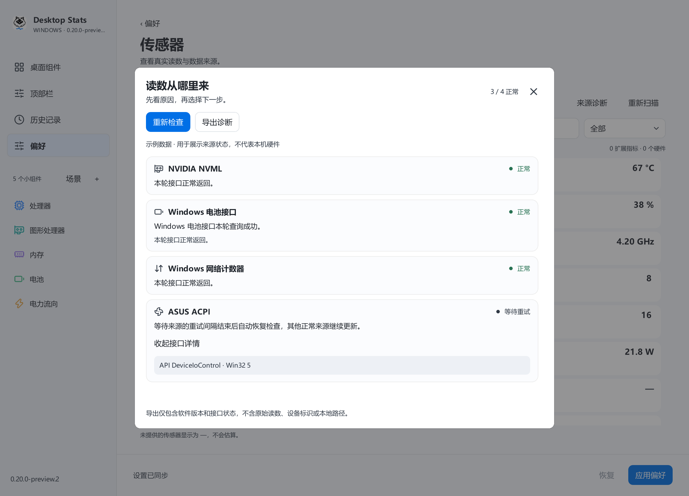](assets/showcase/source-diagnostics.png) |
| 内置方案、自存布局与上次布局恢复。 | 分开显示来源状态，接口详情按需展开。 |

## 功能

- 桌面卡片、横条、竖条；组合或独立显示，支持自适应布局、拖动排序与对齐吸附。
- 多屏顶部栏；按需选择指标、显示样式、位置和单位，悬停查看详情。
- 顶部栏提供经典菜单栏、分组胶囊和精密仪表三套整体设计，真实预览直接选择；组合、悬停、固定详情及溢出入口保持一致。
- CPU 与 GPU 支持组合读数：同一格放入最多四项指标，整组拖排，组内可调整内容和顺序。
- CPU 详情显示逐逻辑处理器使用率，并关联频率、温度、功耗和风扇读数；缺测与过期保留说明。
- 指标行右侧直接调整或删除；组合编辑可确认或取消。图标动效按项选择，强度和速度连续可调，默认关闭，并遵循系统减少动画设置。
- 动效围绕图标局部结构呈现，保留清晰的静态轮廓；彩色细节和节奏随真实读数平滑变化，不作为告警或标定转速。详情按当前读数、真实趋势、核心和相关测量排列。自动切换网卡或系统卷后，图表仍只显示当前设备的历史，不混入其他设备。
- 网络上下行、磁盘读写、电池充放电支持同框显示。
- 六种皮肤、连续透明度和圆角、可选标题与图表；全局默认和单组件设置独立。
- CPU、GPU、内存、电池、网络、磁盘与部分温度、功率、风扇读数。
  每项数据保留来源与不可用原因，不把缺测显示为零。
- 设置分区保存，支持撤销、导入导出、多语言及 0.01–5 秒请求采样间隔。
- 本机历史记录，支持 10 分钟、1 小时与 24 小时查看；折线保留缺测，聚合保留峰值范围。
- 日常办公、性能观察、续航场景，以及自存布局和上次布局恢复；先预览再应用。
- 来源诊断先显示原因和下一步，接口错误按需展开；支持重新检查与脱敏导出。

使用随硬件而异。普通电脑不一定提供整机输入功率或噪声传感器；本软件不从
CPU/GPU 功率推算整机功率，不从风扇转速编造分贝。更快的请求间隔不保证硬件
以同样频率返回新读数。Windows 透明效果、系统策略及显示驱动可能影响玻璃效果。

## 安装与使用

公开预览目前提供经过检查的源码快照，Windows 安装包暂未发布。

解压 Windows 发布包，保留 `DesktopStats.exe` 与 `_internal` 在同一目录，运行
`Install.cmd`。源码包不能直接当作安装包使用。托盘图标可打开设置或退出程序。
升级前先应用或撤销未保存设置，安装程序会保留可恢复的旧安装备份。

在“桌面组件”按 **＋** 添加模板，在“顶部栏”选择屏幕与样式；各页面的“应用”
只保存当前区域。更多操作、传感器来源与限制见 [使用和开发说明](docs/USER_GUIDE.md)。

“历史记录”可独立暂停和清空，数据仅保存在本机。按来源原始时间戳记录，最多每秒
批量写盘一次；不把重复读取的缓存当作新的硬件样本。新功能不改变既有玻璃合成路径。

## 开发与检查

Python 3.12、Windows x64：

```powershell
python -m venv .venv
.\.venv\Scripts\python.exe -m pip install -r requirements-build.txt
.\.venv\Scripts\python.exe tools\fetch_sensor_dependencies.py
.\.venv\Scripts\python.exe tools\build_collector.py --self-test
.\.venv\Scripts\python.exe tools\test_isolated.py
.\.venv\Scripts\python.exe tools\export_source.py
```

检查使用独立数据目录和离屏绘制，不操作鼠标、不打开桌面测试窗，也不改正在运行
的软件配置。离屏检查只能验证布局与交互，不能证明原生 Windows 磨砂效果。
源码导出按白名单包含当前快照和文件校验清单，不包含旧版本程序、私人配置或日志。
源码快照不携带第三方 DLL 或采集器 EXE。依赖准备工具只从固定的官方发布获取
经校验的九个库，不执行下载内容；随后由本机编译原创采集器。构建需要已有的
Windows .NET Framework 编译器；脚本不会自动安装驱动或 SDK。
打包与依赖重建步骤见 [开发说明](docs/USER_GUIDE.md#develop-verify-and-build)。

电弧图集已经包含在源码中，正常运行和打包无需重新生成。需要修改动效素材时，
另行安装 `requirements-artwork.txt`，运行
`python tools/generate_metric_motion.py --output assets/metric-motion-new`。
生成器写入新的项目内目录，保留现有素材和清单；使用新资源前核对生成参数、
实际小尺寸动画和哈希。Three 算法署名与 MIT 例外见第三方说明。

The application runs locally with Python/PySide6. The packaged build needs no
browser, Rainmeter, Python installation or cloud login. Original application code
is source-available under PolyForm Noncommercial 1.0.0; this is not an
OSI-approved open-source license. Third-party notices and LGPL library replacement
rights remain intact. See [LICENSING.md](LICENSING.md),
[third-party notices](THIRD_PARTY_NOTICES.md) and [changes](CHANGELOG.md).
