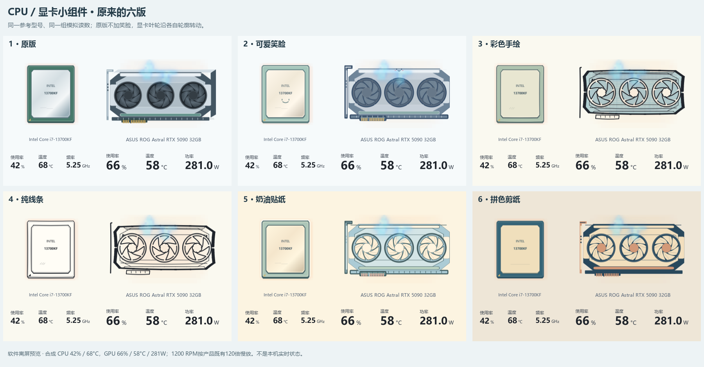
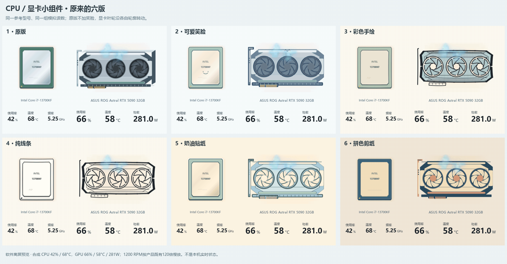
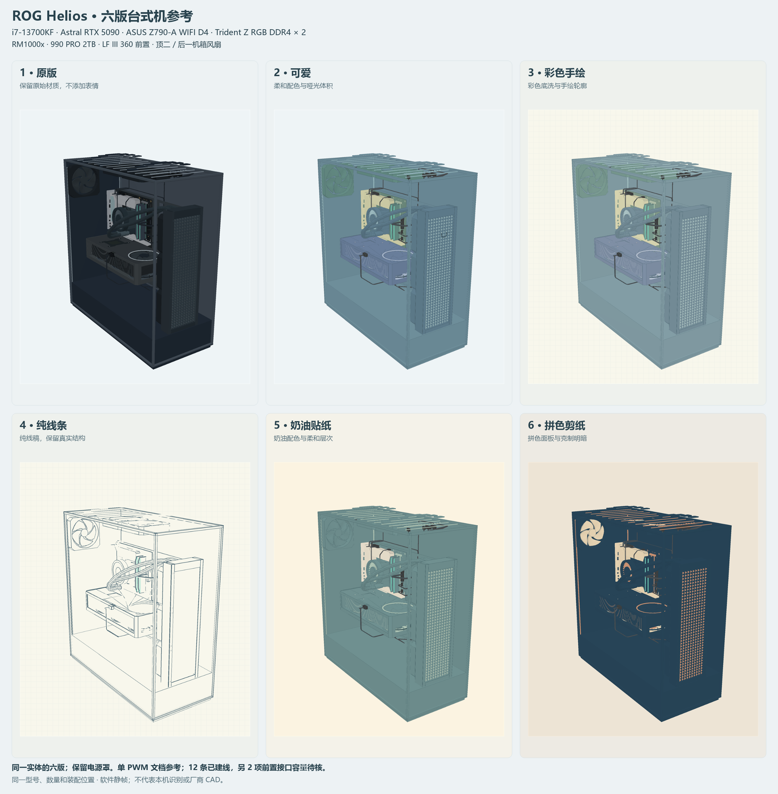
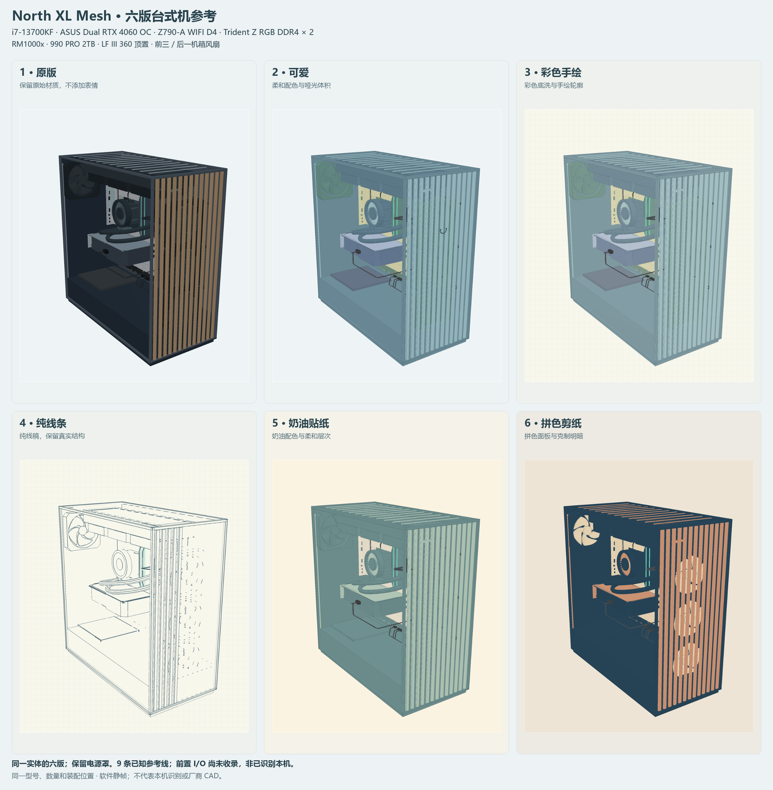

# Desktop Stats 0.51 · 按需预览与独立三维参考

[下载独立三维模型包](DesktopStats-protected-reference051.zip) · [原版GLB](helios-independent-protected051.glb) · [节点清单](model-nodes051.json) · [公开模型质量报告](public-model-quality051.json)

[对应程序源码](https://github.com/Fairank/DesktopStats/tree/b48f178155010845fbf79c3e37a07a944d5f9b37)。这里是独立按需下载的数据，不是程序必装资源，也不是Stats可导入的.dspack；不增加程序启动依赖、采集器、常驻线程或轮询。Node仅供独立离线发布/验签工具使用，不是程序启动依赖。

## 六版与装配参考

[Intel显卡六版](gpu-intel-six051.png) · [华硕Dual显卡六版](gpu-asus-dual-six051.png) · [AMD显卡六版](gpu-amd-six051.png) · [CPU水冷/内存局部](cpu-vrm-six051.png) · [独立PSU六版检视](psu-six051.png)

1原版、2可爱、3彩色手绘、4纯线条、5奶油贴纸、6拼色剪纸；原版不添加笑脸。六版共享各自的实体结构，不把换色当作新增硬件。冷头小风扇为LFIII型号自带VRM辅冷。整机图保留PSU罩和真实遮挡，独立电源图是明确的局部检视。

如画面出现温度、负载或demo RPM，均为合成演示，不是当前电脑实测；未知读数不能据参考模型或参考接线补数。软件离屏静图/动画不等同Windows原生窗口、真实游戏隐藏、磨砂效果或重启后温度的实机验收。RM1000x标注1000W为额定容量，实际功率未知，无OLED功率屏。

## 模型能做什么、还缺什么

398个原始Mesh各自保留独立子节点；18个原非空part_id父组、3个空ID的component显式回退父组、12个按真实线缆元数据派生的检视组，见model-nodes051.json。派生组不是新硬件或新增runtime part_id。

节点可独立检视不代表全部机械拆装已完成；仅保留现有有限GPU方向动作，供电线对应真实节点动作，不模拟全机通电或所有锁扣。模型不是全部市场硬件目录，也不是制造精度或任意组合安装保证。原厂照片、CAD和纹理不在此分发中，商标和产品名归各自权利人。

Helios参考装机有12条已建参考线，另外2项前置接口容量待核；North的9条已建参考线不等于其未收录前置I/O已接齐。完整说明见[模型说明](模型说明.txt)。

## 不可见来源辅助标识

最终PNG/GIF的像素或调色板、GLB的f32几何中含不可见标识，并非仅文件metadata。每个资产的.watermark.json包含发行签名，公开汇总为[public-summary051.json](public-summary051.json)。正式发布时另附签名RELEASE_INDEX.json；整理目录本身不是完成发行或提取通过的证明。

GLB仅20/21参考组有可用容量，透明panel容量0；整件检出不等于每个小网格或全部目录都受保护。公开无钥质量报告可验证签名、字节与几何质量；来源标识的提取结果只按签名收据的发布者证明陈述，不能冒称无钥独立提取。

来源标识是辅助证据，不自行证明所有权、违法使用或法律胜诉；不抗remesh、量化、坐标烘焙、JPEG/调色板重编码等变换，未检出也不等于没有侵权。所有下载者获得相同标识，无用户ID或公网追踪。发布私钥和提取密钥不在本包或客户端。

先从已知项目来源核对公钥指纹，不能只因可疑文件附带公钥就信任。当前key_id：`7055a716d2763fc595eb150e4d2a1c07a965d8ca8a053d3255f93812ee7ef0f7`，公钥文件为[publisher-public.json](publisher-public.json)。

## 许可与转载

[完整LICENSE](LICENSE) · [NOTICE](NOTICE) · [许可范围与例外](LICENSING.md) · [第三方说明](THIRD_PARTY_NOTICES.md)。原创材料未经相应权利人另行授权不得商用盈利；第三方及既有许可例外完整保留，不能用本项目条款覆盖第三方权利。转载保留Required Notice、项目来源和完整许可。模型与软件的开放下载不转让厂商商标、照片、CAD或专有设计许可。
