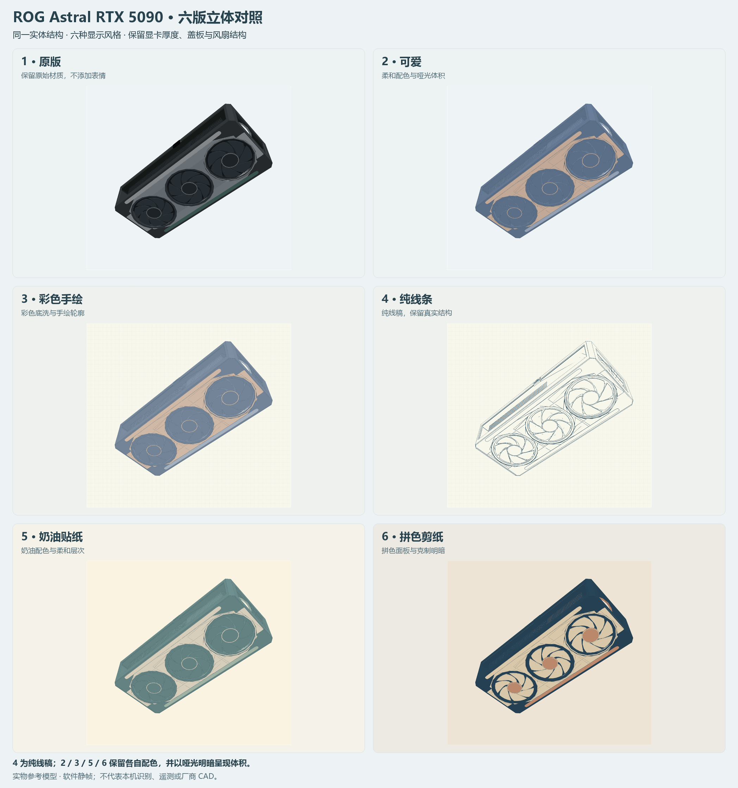
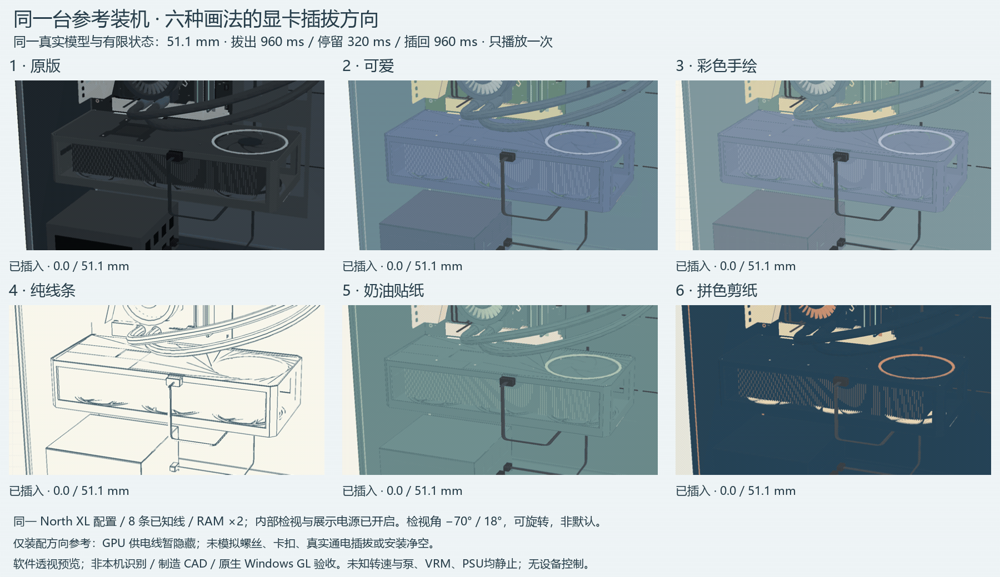

# 隐形来源标记资产 · 0.50

[下载独立三维模型包](DesktopStats-protected-reference050.zip) · [应用与发布工具源码](https://github.com/Fairank/DesktopStats/tree/codex/invisible-watermark-v050) · [水印范围与验证说明](https://github.com/Fairank/DesktopStats/blob/codex/invisible-watermark-v050/docs/WATERMARK050.md)

本分支只含按需下载的原创建模参考和预览数据，未增加Stats运行时采集、动画循环或强制下载。模型不是当前Stats可导入的.dspack，也不代表全部产品或完整机械拆装已完成。

## 非商业用途与转载

原创项目材料遵守完整LICENSE；未经权利人另行书面授权，禁止商业使用、商业集成、出售或用于商用盈利。转载保留LICENSE/Required Notice/项目来源，第三方和既有授权例外见LICENSING.md等原文。厂商照片、CAD和图像不在此包，产品名/商标权属于其原权利人。

## 真正的隐形标记

模型标记位于f32几何数据，原363网格/393节点/法线/索引/材质/有限动画不变；PNG/GIF标记位于最终RGB像素或调色板，通道最多变化1。它们不只是文件署名标签。发布原件SHA和Ed25519签名见各.watermark.json及RELEASE_INDEX.json。所有下载者得到相同资产标记，无User-ID、无网络追踪，私密提取密钥不在仓库或客户端。

先从已知仓库核对公钥指纹，不能仅因可疑文件带着一把公钥就信任它。当前指纹：`7055a716d2763fc595eb150e4d2a1c07a965d8ca8a053d3255f93812ee7ef0f7`。

标记能辅助核验来源，不能自行证明创作归属、违法使用或胜诉。改名/GLB删附加字段/无损元数据处理已测试；JPEG、重调色、量化、坐标烘焙、重网格可能使标记失效。未检出也不等于没有侵权。本地时间不是可信司法时间戳。

## 六版原有外观

原版无笑脸，其余风格保持原设计。0.49未标记历史原件及已知功能缺项见应用源码，不能把本轮标记追称为旧发布已有。
