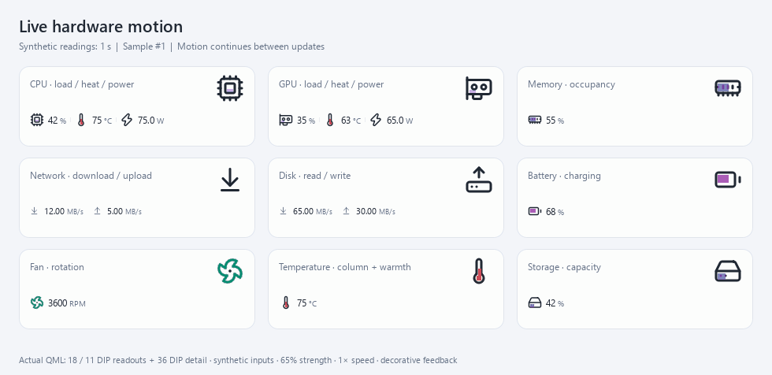

# 视觉效果与使用指南

年糕的顶部栏把读数、趋势和可选动效放在一起。数字显示测量结果，动效帮助快速辨认活动状态。

## 动态演示

每秒更新一次合成读数，动画在两次读数之间继续运行。读数使用实际的 18 / 11 DIP 图标，
右上角另有 36 DIP 细节参考。演示强度为 65%，速度为 1×。

| 浅色 | 深色 |
| --- | --- |
| [](assets/showcase/motion-continuity-light.gif) | [](assets/showcase/motion-continuity-dark.gif) |

演示通过真实控制器和 QML 组件离屏绘制，使用明确的合成数据。GIF 以固定 20 fps 导出，
用于说明外观和行为，不代表实际电脑帧率、传感器精度或 Windows 系统磨砂的验收。

## 开启动效

1. 打开 **顶部栏**，在指标右侧点击调整按钮。
2. 选择 **图标与数值**；网络上下行、磁盘读写等也可选择双向显示。
3. 将 **图标动效** 设为 **硬件联动**，按需要调整强度和速度。
4. 点击 **应用顶部栏**，保存这部分设置。

动效默认关闭，按指标单独选择。强度连续可调；速度范围为 0.5–2×。
文字、趋势图和仪表等样式保留各自的显示方式，不会为了展示动效强行添加图标。

## 各种硬件的表现

| 图标 | 视觉反馈 | 使用哪些读数 |
| --- | --- | --- |
| CPU / GPU | 内部活动、黄橙红热弧、蓝白电流可同时出现；电弧从不同位置间歇出现和消退 | 对应设备的使用率、温度、功耗分别驱动各层；缺少的通道不显示 |
| 温度计 | 温柱平滑变化，局部黄红热晕轻轻呼吸；没有电流或火花 | 当前温度；转换 °C / °F 不改变活动强度 |
| 风扇 | 叶片围绕固定轴心连续旋转，高速时更快并有轻微叶片拖影；转速变化时平滑调整速度 | 当前风扇转速或百分比；动画不是实际 RPM 的逐圈复现 |
| 内存 / 显存 | 内部填充和局部活动随占用变化 | 对应内存的实际占用；不借用 CPU 温度或功耗 |
| 网络 | 下载与上传的方向、颜色和节奏分别变化，支持同框显示 | 所选网卡的上下行读数；MB/s 与 Mbps 转换不改变活动强度 |
| 磁盘读写 | 读与写分别显示方向性活动 | 所选设备的实际读写速度 |
| 电池 | 电量影响填充，充放电影响对应方向的活动 | 电量与已提供的充放电功率；不能从接通电源推算充电功率 |
| 卷容量 / 存储温度 | 容量显示占用；温度计显示温柱与热感 | 对应容量或温度；损耗、健康度不会被当作实时负载 |

硬件联动保留十个视觉阶段之间的连续过渡，**真实读数不会被分成十档**。
电弧是装饰性的状态反馈，不表示检测到了物理放电、故障或达到了硬件警戒线。

### 风扇速度与噪声

风扇的视觉速度随真实转速连续上升，可再用 0.5–2× 调整。高速旋转保留轻微拖影，
速度上限用于减少小尺寸四叶图标出现反转错觉；停转、缺测、隐藏或减少动画时仍停止。

旋转按绘制帧推进，转速变化不会重启动画。偶发慢帧下限制单次旋转幅度，减少突然跳步或反转错觉。
其他特效维持独立的更新节奏；没有活动风扇时，使用原有的低频共享时钟，避免让所有通道一起加速。

支持的显卡绘图后端把同一电弧的四个图像格合成一次绘制；软件绘图或着色器失败时使用原来的图像路径。
这项优化保留电流的颜色、细节、透明叠加顺序和动画频率，不改变硬件读数或采样间隔。
着色器源码与 Qt 绘图资源位于 `assets/shaders/`；使用 PySide6 配套的 Qt 6.10.2 `qsb` 可重建：
`qsb --glsl "100 es,120,150" --hlsl 50 --msl 12 -o assets/shaders/metric-discharge.frag.qsb assets/shaders/metric-discharge.frag`。

扩展采集器现在接收 LibreHardwareMonitor 实际提供的 **Noise / dBA** 通道，
单位遵循其 [0.9.6 传感器定义](https://github.com/LibreHardwareMonitor/LibreHardwareMonitor/blob/v0.9.6/LibreHardwareMonitorLib/Hardware/ISensor.cs)。
在 **添加指标 → 全部指标** 中选择发现的噪声传感器即可加入顶部栏或组件；
风扇详情也显示发现的环境噪声来源。环境声可能包含多个设备，不能归因于某一个风扇。

没有此通道时显示缺测与当前采集状态。仅凭本轮未发现通道，不能判定整机不支持。
本版不启用麦克风、不增加硬件驱动，不按 RPM 换算分贝。

## 其他动效选项

**硬件联动** 根据当前指标和可用通道选择表现，也可以手动选择热感、流动、旋转或呼吸。
选项按指标提供，保留硬件语义：温度计始终使用温柱与热感，风扇始终以旋转表现。
希望更安静时，可以降低强度、减慢速度，或直接关闭。

窗口隐藏、最小化或系统启用“减少动画”时，动效停止并释放共享时钟的订阅。
风扇停转、相关活动为零或数据缺失时，对应效果停止；静态图标和缺测说明保留。
CPU 使用率为零时，若温度或功耗仍有有效读数，其独立效果可以继续存在。

## 整体设计和排列


| 整体设计 | 外观 |
| --- | --- |
| 经典菜单栏 | 轻盈排列，突出数字与小图标 |
| 分组胶囊 | 用柔和底板组织每项指标 |
| 精密仪表 | 更清楚的基线、分隔和局部刻度 |

三种设计共用指标、设备选择、拖动排序、悬停详情和固定详情操作。
单项可选择标签与数值、仅数值、图标与数值、上下两行、趋势与数值、迷你图表等方式；
适用指标另有条形、环形和双向显示。

CPU / GPU 可以把最多四项读数放在同一格，例如“使用率 + 温度 + 功耗”，整组拖动和展开详情。
网络上下行与磁盘读写可用两行或单行同框显示。


## 皮肤和磨砂材质

清透玻璃、柔雾玻璃、柔彩玻璃、经典卡片、石墨黑和极简数字用于不同的信息密度与背景。
组件可以跟随全局，也可以单独选择皮肤、透明度、圆角、标题和图表。顶部栏也可单独选择外观。

Windows 系统磨砂受透明效果、系统设置和运行环境影响；预览图不代表系统已经启用磨砂。
不支持时保留清楚的内容和状态说明。项目不把普通透明叠色宣称为苹果式的背景折射。

## 数据更新与动画

动画使用每个窗口共享的时钟。正常读数更新只改变目标强度或速度，由动画平滑接近新目标，
不会重新创建图标、从零开始转动或重置电弧周期。采样间隔、数值更新和动画节奏分别处理，
不需要加快传感器采样来获得连续动画。

修改指标成员、增删或重新排列结构时，相关视图可以重新建立。缺测、停转和关闭动效仍按规则停止，
不会用保留旧动画来掩盖过期数据。Qt 界面仍共享 GUI 线程；这里的分离不表示另外创建了独立
渲染进程，也不是对所有机器绝不卡顿的承诺。

## 重现演示

安装版支持固定配置位置。桌面快捷方式、托盘和开机启动可以读取同一个已明确选择的配置；
选择文件损坏时明确报错，不退回默认配置。旧配置不会自动合并或删除，开发测试的独立数据目录也保留。

开发环境安装普通依赖和 `requirements-artwork.txt` 后，可运行：

```powershell
python tools/render_motion_continuity.py --output-dir visual-preview
```

工具只创建自身的离屏窗口，使用合成数据，不截取桌面、其他软件或真实硬件信息。
导出时检查每次读数更新后图标实例保持不变。已有输出需要明确加 `--overwrite` 才会替换。

应用源码与原创说明遵循 [项目许可](LICENSE)；第三方素材和依赖的权利见
[许可范围](LICENSING.md) 与 [第三方声明](THIRD_PARTY_NOTICES.md)。
