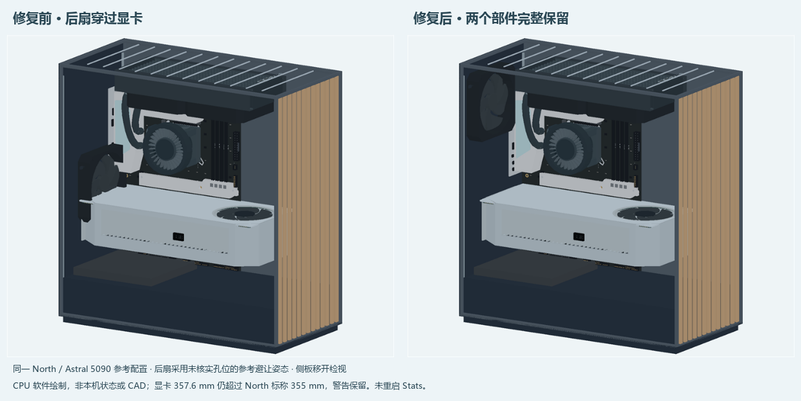
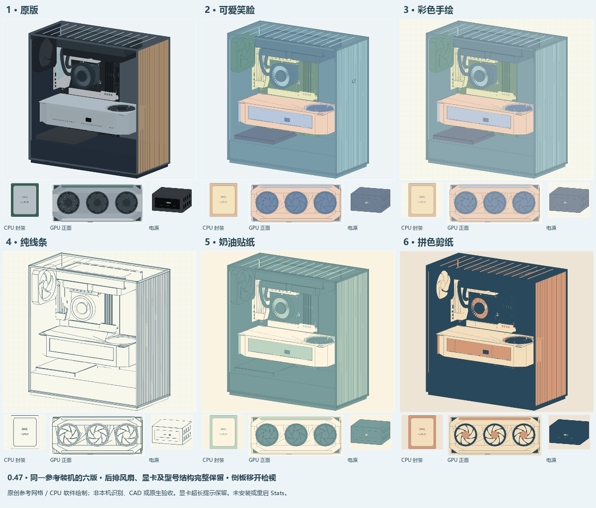

# 后排机箱风扇与显卡重叠修复

用户截图中的后排风扇占到了显卡壳体的位置。复现确认：旧参考安装面把后扇放在机箱中线，创建前只检查安装面、尺寸和数量，没有检查已选显卡的占用空间。

本轮保留风扇、显卡、型号和尺寸，调整没有专属安装面时的后排参考姿态至左上区域。已明确编写的安装面保持原坐标；若仍与已选实体的参考包络冲突，会省略整组风扇并提示冲突。不会缩小显卡、截掉风扇、静默少装一把或篡改已核安装位。

## 已检查

- 实际型号轮廓转换后的 North、5000D、Y70：各自保留一把后扇，与显卡各实体没有包络重叠。
- 扩大到目录 96 款中的 48 款已核后扇 120 安装面：42 组保留、6 组因所选组合冲突而整组拒绝。保留组与实际生成的 GPU／电源／存储／扩展卡刚性网格无所检查的包络重叠。48 例均生成 GPU、电源、存储，46 例生成扩展卡，另两例保留附件拒绝原因；不将未生成附件算成通过。
- North、Y70、O11D 三例各 13 个保留风格，物理顶点数组保持同一对象，姿态／轴／转子／方向／冷却元数据一致；主展示仍固定六版。
- 110 款已收录风扇 × 3 档细节的实际顶点包络检查通过，涵盖圆框耳片、减震垫、定子、LCD／格栅与旋转叶片完整扫掠。5 款旧矩形界未包住安装耳片，现已修正；AP183 另加了保守轴向余量，其旧界原已包含实际顶点。没有改风扇造型来掩盖重叠。
- 六版切换复用物理数组，保留风扇数量、轴、叶轮和未知 RPM。三档细节的后扇姿态相同。
- 明确给定且有冲突的安装面不自动移动。两把风扇中一把遇阻时，整组拒绝，避免留下未说明的数量变化。
- 旋转所扫过的空间也参与检查；不能因某一静止角度没有叶片遮挡，就允许显卡进入风扇叶轮区域。

回归：[test_case_fan_clearance047.py](../tests/test_case_fan_clearance047.py)、[test_case_fan_envelope047.py](../tests/test_case_fan_envelope047.py)、[test_assembly_cooling.py](../tests/test_assembly_cooling.py)。最终 48 例与 Torrent 四组合检查用时 38.739 秒；补充第三例风格缓存桥 0.973 秒，两段的 50 个相关源码 SHA256 均未改变。此为几何验证耗时，不是程序日常占用。

图来自真实生产网格的软件绘制，侧板仅在检视绘制时移开，风扇和显卡的网格保持完整。图不是本机识别或 Windows 原生验收，也不是全部型号或实物安装证书。

## Torrent 顶置电源

Torrent TG 的后扇在顶置电源下方。[官方手册第 39 印刷页](https://assets.fractal-design.com/files/uxzbxy2o/production/af5f587352e8fa20cb09151326dae43796eebb44.pdf)支持这个结构关系；本轮据此把默认后扇参考高度设为机箱高度的 0.14，未冒充厂家螺孔坐标。风冷／前排 AIO × 后扇 120／140 四组合均保留，Y 坐标同为 74.2 mm；与参考电源的竖直净空分别为 32.375／22.375 mm。实测 RPM、孔位及 CAD 验证状态仍为未知／否。

## 边界与资源

检查采用保守包络。它包含风扇完整叶轮扫掠区、少量边框／固定外凸参考余量，以及已生成的 GPU、主板散热装甲、CPU、内存、冷却实体和已选辅助实体。风冷和 AIO 也在检查前构建一次电源／存储／扩展卡实体，随后复用同一批实体生成线缆，避免漏扫顶置电源或重复生成。没有检查全部机箱壳体、螺钉、公差、任意管路、线缆或未生成的附件。包络冲突只说明当前参考装配应调整，不自动断言现实产品一定不兼容。

左上后扇姿态是参考，未经厂家孔位尺寸或 CAD 验证。North 的实际后扇规格、240 顶排及 355 mm 显卡限长见[厂商资料](https://www.fractal-design.com/products/cases/north-series/north/north-chalk-white/)。图中 Astral 5090 超过其标称限长，这项提示继续保留；修后扇不能给整台装机打兼容勾。

新增检查只在选择变更后的几何构建时进行；切换外观复用同一物理场景，不增加逐帧碰撞、硬件查询、采样器或时钟。整款程序的 CPU／RAM／GPU 占用仍待后续原生验收。
