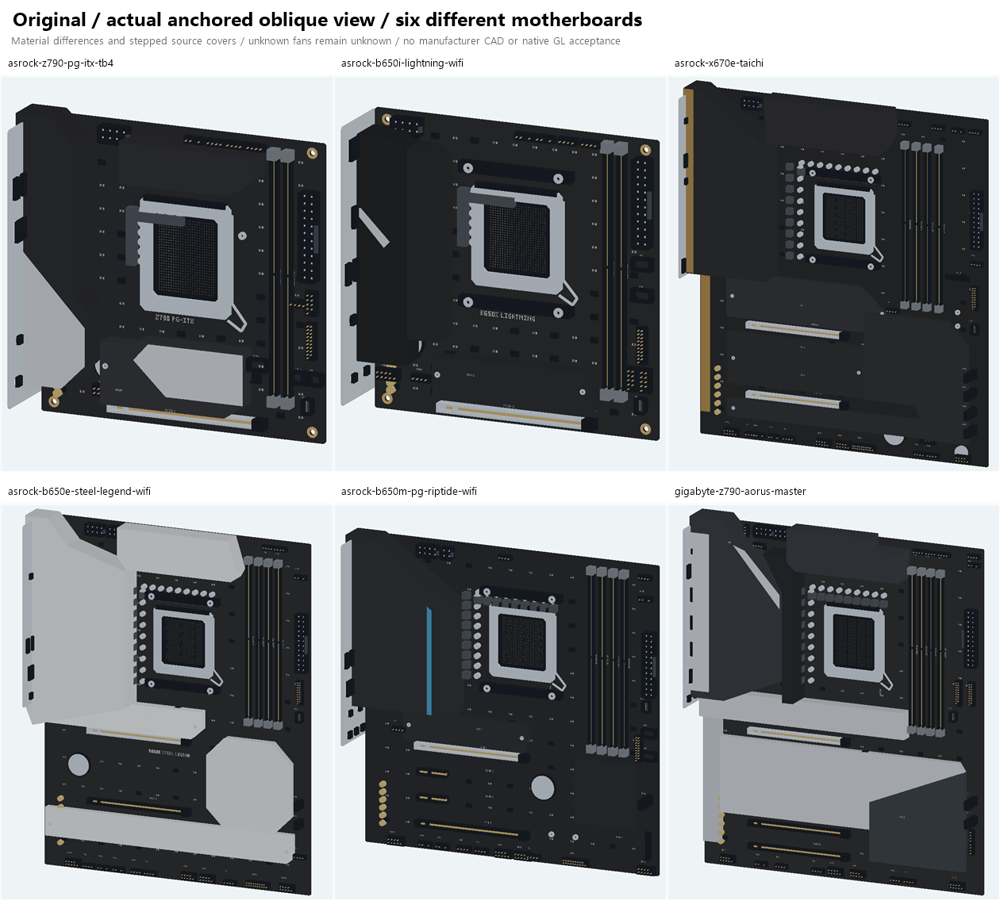

# 0.47 六款主板外观细化

本轮更新六个已有主板记录的 PCB 底色、装甲外轮廓和静态材质饰条。原有 CPU、DIMM、PCIe、前后侧 M.2、接头和安装孔记录继续沿用。主板库仍有 28 个具名记录，其中其余 22 个记录的数据、原始板件几何及六版颜色保留 0.46 的校验结果。

官方手册支持既有尺寸、接口数量与布局观察；官方正面照片支持本轮外观观察。图中覆盖区采用原创的低顶点轮廓。照片比例、厚度、倒角、饰条厚度与颜色均保留参考状态，`photo_reviewed` 表示已查看来源照片。厂商 CAD、精确扣具净空和实物安装仍未验收。

## 六款各自改了什么

| 精确记录 | 本轮外观特征 | 保留的边界与未知 | 主要来源 |
| --- | --- | --- | --- |
| ASRock Z790 PG-ITX/TB4 | 较长的左侧 I/O 盖、上侧散热区、较宽的前置 M.2 盖；深色主体搭配两处银色静态饰条。 | 两条 DIMM；一前、两后的原生 M.2 位置保持；背面槽没有被画成额外前置盖板。 | [产品页](https://pg.asrock.com/mb/Intel/Z790%20PG-ITXTB4/index.asp)、[正面参考](https://www.asrock.com/mb/photo/Z790%20PG-ITXTB4(L2).png) |
| ASRock B650I Lightning WiFi | 左侧 I/O 盖与邻接散热区分层；短前置 M.2 盖及银色斜饰条。 | 移除缺乏正面依据的上侧 VRM 盖；两条 DIMM、前后 M.2 布局保持。银色饰条没有注册为发光区。 | [产品页](https://pg.asrock.com/mb/AMD/B650I%20Lightning%20WiFi/index.asp)、[正面参考](https://www.asrock.com/mb/photo/B650I%20Lightning%20WiFi(L2).png) |
| ASRock X670E Taichi | 深色左、上侧 VRM 装甲、分层 M.2/芯片组区域，以及两条铜色静态边饰。 | 手册中的 E-ATX 布局保持。官方确认的主动 VRM 散热风扇，其尺寸和位置仍未核实；齿轮图案没有变成叶轮。可选 M.2 风扇附件仍未装入。 | [产品页](https://www.asrock.com/mb/AMD/X670E%20Taichi/index.asp)、[正面参考](https://www.asrock.com/mb/photo/X670E%20Taichi(L2).png) |
| ASRock B650E Steel Legend WiFi | 深色 PCB 上的银色 I/O、VRM、M.2 与芯片组覆盖区，保留不同区域的边界。 | 没有把印刷配色变成整块白 PCB；附送的外部显卡支架没有自动安装。已观察的灯区仍待独立实现。 | [产品页](https://www.asrock.com/mb/AMD/B650E%20Steel%20Legend%20WiFi/index.asp)、[正面参考](https://www.asrock.com/mb/photo/B650E%20Steel%20Legend%20WiFi(L2).png) |
| ASRock B650M PG Riptide WiFi | mATX 的深色左侧装甲、短 M.2 盖、芯片组盖和蓝色静态竖饰条。 | 移除缺乏正面依据的上侧 VRM 盖。蓝色印刷饰条保持静态材质，没有借用 RGB 接口来推断灯光。 | [产品页](https://pg.asrock.com/mb/AMD/B650M%20PG%20Riptide%20WiFi/index.asp)、[正面参考](https://www.asrock.com/mb/photo/B650M%20PG%20Riptide%20WiFi(L2).png) |
| GIGABYTE Z790 AORUS MASTER **rev.1.0** | 7 个简化覆盖区域：深色 VRM/I/O 区、上侧散热区、银色上 M.2 与共用下 M.2 区、下右芯片组区和音频侧盖；两处银色静态饰条。 | 采用 rev.1.0 画廊，未混用 MASTER X。两处 M.2 外观覆盖区不改变原生 5 槽记录，也不代表已安装 SSD。彩色/反光图形没有被推断为灯。 | [rev.1.0 产品规格](https://www.gigabyte.com/Motherboard/Z790-AORUS-MASTER-rev-10/sp)、[rev.1.0 官方画廊](https://www.aorus.com/motherboards/z790-aorus-master-rev-10/gallery) |

ASRock 的照片与精确产品页关联，未据此推断额外的 PCB 修订编号。两款 ITX 原有四个参考孔位仍标为未核实；其余四款未知安装孔坐标继续为空。

## 六版材质与兼容范围

编号继续使用：1 原版、2 可爱笑脸、3 彩色手绘、4 纯线条、5 奶油贴纸、6 拼色剪纸；13 个既有保存值保持兼容，没有增加新风格。

本轮发现剪纸版原有的三档调色会把黑色 PCB 与深色金属装甲合并。现在仅上述六款具名记录显式提供 PCB、装甲、静态饰条三种材质角色：原版保留来源参考颜色，线条版保留白底线稿，其余画法使用已有调色板中的层次。几何、零件标识和风扇状态不随调色改变。其他主板不会因通用零件名称而获得这些角色。

原有 ASUS 透明 I/O 饰片限制在已经编写的三个精确型号中，并按 `vrm-io` 名称获取深度。盖板顺序改变或其他型号设置同名开关，都不会借用该形状。

## 原创模型预览

以下为实际板件几何的离线 CPU 软件光栅图。原版无表情；没有加入未知叶轮、虚构转速或额外发光区。

- [Z790 PG-ITX/TB4 六版](../assets/showcase/motherboard047-asrock-z790-pg-itx-tb4-six.png)
- [B650I Lightning WiFi 六版](../assets/showcase/motherboard047-asrock-b650i-lightning-wifi-six.png)
- [X670E Taichi 六版](../assets/showcase/motherboard047-asrock-x670e-taichi-six.png)
- [B650E Steel Legend WiFi 六版](../assets/showcase/motherboard047-asrock-b650e-steel-legend-wifi-six.png)
- [B650M PG Riptide WiFi 六版](../assets/showcase/motherboard047-asrock-b650m-pg-riptide-wifi-six.png)
- [Z790 AORUS MASTER rev.1.0 六版](../assets/showcase/motherboard047-gigabyte-z790-aorus-master-six.png)

## 验证与仍待完成

[新增回归](../tests/test_motherboard_finish047.py)覆盖六款记录的布局字段、22 款旧记录的校验、旧板件双精度载荷与六版颜色、盖板底座/凹槽顶盖配色、ASUS 饰片范围、静态饰条、未知风扇、13 个保存值下的三档细节预算及实际装机场景。缓存切换画风时继续复用物理顶点。单体预览按实际主板法线选取正面与斜视相机，六版使用同一物理模型。

本轮未增加采样器、线程或动画时钟。材质在构建或切换画风时计算；未重新测量安装版本的原生占用，也未进行 Windows 原生 GL 或实物安装验收。

仍保留的缺项：

- 六款之外的型号、品牌和修订仍按各自既有覆盖状态记录；本轮没有完成市场全部主板。
- 散热片微细结构、精确深度、螺钉/扣具尺寸、反光参数和色度测量仍未核实。
- Taichi 隐藏 VRM 风扇的位置、尺寸、叶型、方向与测速映射未核实，继续不画出猜测的转动。
- Taichi、Steel Legend、Riptide 的来源观察灯区尚未完成独立几何、发光材质及灯区预览注册；接口数量不作为已装灯光的证据。
- 完整机箱中的最终净空和遮挡还需结合具体装机继续核对；这些外观记录不提供 CAD 级相容保证。

官方照片和观察叠图仅留作私有参考，未加入安装包或公开资源。项目原创代码和生成图遵循[项目授权](../LICENSE)及[授权范围说明](../LICENSING.md)；[第三方条款](../THIRD_PARTY_NOTICES.md)保持原范围。产品名称与商标保留其权利归属。
